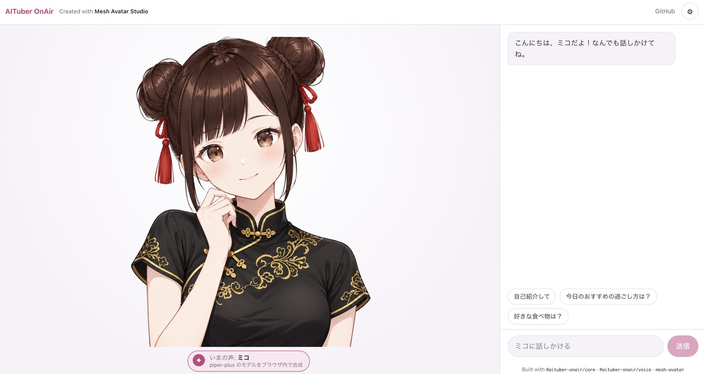

# Mesh Avatar Chat（デモ）

[English README](./README.md)

<a href="https://shinshin86.github.io/aituber-onair/mesh-avatar-chat/">
  
</a>

**公開ページ:** https://shinshin86.github.io/aituber-onair/mesh-avatar-chat/

AITuber OnAir の公式キャラクター「ミコ」を
[メッシュアバター](https://github.com/shinshin86/mesh-avatar-studio)として描画し、声と口パクと表情つきで会話できる、ブラウザだけで動くデモです。サーバーはなく、GitHub Pages に公開します。

- 会話: Chrome 内蔵の Gemini Nano（キー不要）、`@aituber-onair/chat` がブラウザから呼べる各社の API（OpenAI、Gemini、Claude、xAI、Z.ai、Kimi、DeepSeek、Mistral、PLaMo、OpenRouter）を自分の API キーで、またはローカル LLM などの OpenAI 互換サーバーを使えます。ブラウザから直接呼べないプロバイダー（現在は Sakana AI）は一覧に出ますが選べません。キーと設定はこのブラウザのローカルストレージにだけ保存されます。
- 声: Web Speech API ですぐに喋ります。裏で [piper-plus](https://github.com/ayutaz/piper-plus) のミコ専用モデルを準備し、準備できたら切り替えられます。取得量は合計約150MB で、内訳はモデル 38MB、OpenJTalk の辞書 102MB、ONNX Runtime と OpenJTalk の WebAssembly 12MB です。合成はブラウザ内で行います。スマホや省データ設定の環境では自動で取得せず、リンクを押したときだけ取得します。
- アバター: 会話と感情タグは `@aituber-onair/core` が処理し、`.mavatar` ファイルは `mesh-avatar` ランタイムが動かします。

## 手元で動かす

先にワークスペースのパッケージをビルドしてから、デモを起動します。

```bash
# リポジトリのルートで
npm install
npm run build

cd demo/mesh-avatar-chat
npm install
PIPER_MODEL_DIR=/path/to/miko-piper-plus-model npm run fetch-piper-assets   # 任意
npm run dev
```

`fetch-piper-assets` は、piper-plus のランタイムと辞書を GitHub Release の tarball から取得し、ミコの音声モデル（`sample-voice-v1.onnx` と `.onnx.json`）を `PIPER_MODEL_DIR` から、またはオンラインに置いた場合は `PIPER_MODEL_BASE_URL` から取り込みます。実行しなくても Web Speech の声で動き、ミコの声の選択肢は表示されません。

## 公開

`.github/workflows/pages.yml` がこのディレクトリをビルドし、GitHub Pages の `/mesh-avatar-chat/` に公開します。ビルド時に piper-plus のランタイムを GitHub Release の tarball（リポジトリ変数 `PIPER_ASSETS_URL`、任意）から、ミコの音声モデルをリポジトリ変数 `PIPER_MODEL_BASE_URL` から取得します。後者はモデルの2ファイルを配信する URL を必ず設定してください。

## クレジットとライセンス

- ミコ © Yuki Shindo（AITuber OnAir）。アバターは[ミコ キャラクター利用ガイドライン](https://miko.aituberonair.com/#terms)に従って提供しています。[MIKO_ASSET_TERMS.md](./MIKO_ASSET_TERMS.md) を参照してください。
- ミコの声は合成音声です。piper-plus の `zs-v1` ベースモデル（MIT）を、Irodori-TTS で生成した音声で追加学習したモデルで、詳細は [licenses/miko-voice-NOTICE.md](./licenses/miko-voice-NOTICE.md) と隣のベースモデルの NOTICE を参照してください。ランタイムの tarball に含まれる piper-plus、OpenJTalk、MeCab、ONNX Runtime Web のライセンスとあわせて、`public/piper/licenses/` として配信します。
