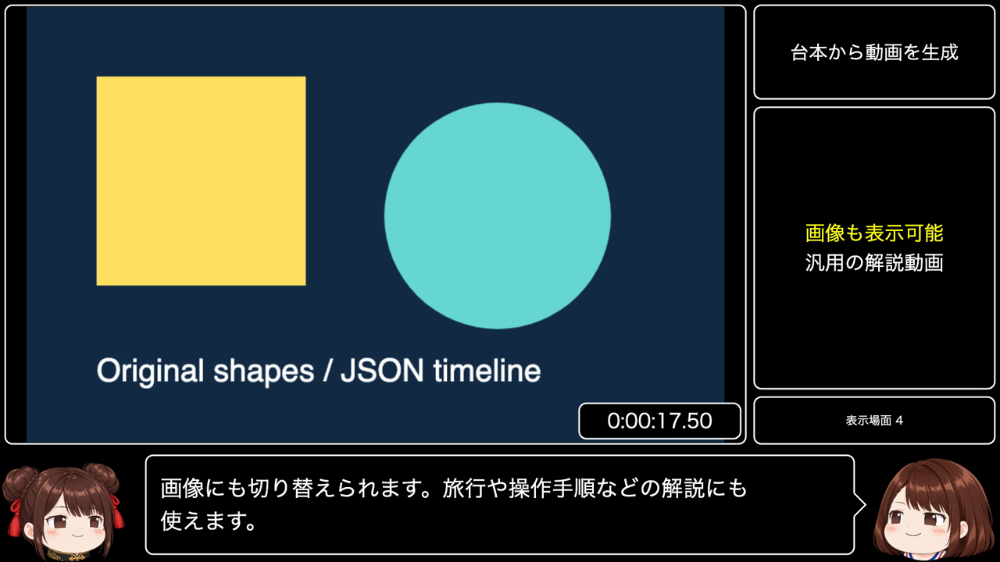
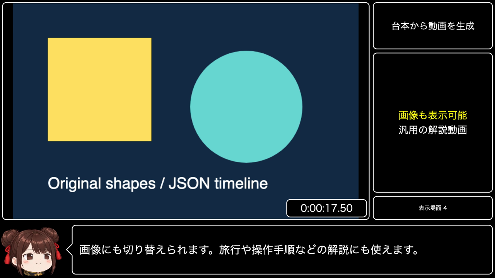

# Biim-style Explainer (Node)

| Two speakers | One speaker |
| --- | --- |
|  |  |

Render an MP4 from a JSON timeline with one or two characters, a main video/image,
right-side information panels, and a two-line speech bubble. This example uses the
screen arrangement commonly called the biim system: black backgrounds, white
window borders, and separately timed commentary. It works for tutorials, travel,
slides, and gameplay. It does not reproduce a particular creator's dialogue.

[日本語](./README.ja.md)

For agents, start with the [authoring guide](./docs/authoring-guide.md) and
[generated field reference](./docs/reference.md). The
[full-feature sine sample](./samples/biim-all-features.json) demonstrates the
combined timeline; bottom-panel/right-bottom-clock variants cover exclusive choices.

## Quick start

Requires Node.js 22+, `ffmpeg` and `ffprobe` on PATH, and a Japanese-capable font.
Set `BIIM_FONT_PATH` to a font file if the system has no suitable font.

```bash
# From the repository root, build the local Core dependency first.
npm ci
npm run build
cd packages/core/examples/node-biim-explainer
npm ci
npm run build
npm run validate -- samples/biim-hello-sine.json
npm run plan -- samples/biim-hello-sine.json --estimate
npm run preview -- samples/biim-hello-sine.json --at 0 --at @speed --out work/preview
npm run gen -- samples/biim-hello-sine.json --out work/hello.mp4
```

Build generates an original four-second test-pattern video, a shapes image and
a 75-second procedural dungeon in `work/`; no binary footage is bundled.
The sine sample produces tones rather than
Japanese speech and needs no API key or speech server. Output includes
`hello.mp4`, `hello.mixed.wav`, and `hello.timeline.json`. `work/` is ignored.

## Commands

| Command | Behavior |
| --- | --- |
| `validate script.json` | JSON Schema, speaker/anchor references, timing dependencies, definite numeric overlaps, widget conflicts, and file existence. No TTS or rendering. |
| `plan script.json` | Synthesize narration and print absolute line, page, main, panel, timer and counter intervals. |
| `plan script.json --estimate` | No TTS. Estimate speech using 8 nonspace characters/sec; override with `--chars-per-second 6`. |
| `plan script.json --json --out work/plan.json` | Print JSON and optionally save it. The `estimated` field distinguishes approximate timing. |
| `preview script.json --at 12.5 --at @intro-2:end --out work/preview` | Save PNG frames; repeated `--at` accepts seconds or anchors. Optional `--estimate` skips TTS. |
| `gen script.json --out work/out.mp4` | Encode H.264/AAC MP4, mixed mono 48 kHz WAV, and timeline JSON. |

All commands run via `npm run <command> -- ...`. For JSON-only stdout use
`node dist/gen.js plan samples/biim-hello-sine.json --estimate --json`.
Paths in a script are relative to that script. CLI `--out` is relative to the
working directory. Preview times must be within `[0, duration)`.

Validation cannot know the duration of unsynthesized speech. `plan` and `gen`
check every resolved overlap using the actual audio. An estimate can flag an
overlap that real audio would avoid, or miss one caused by longer audio. Prefer
anchors over fixed seconds when timing depends on speech. Video planning probes
source durations with ffprobe, including in estimate mode.

Audio is cached in `work/voice-cache/` by a hash of engine settings and reading
text. Preview, plan, and generation reuse it; delete that directory to refresh
voices after changing server presets. Scripts and credentials are not copied into
timeline artifacts. A synthesis failure reports the line index and speaker.

## Script reference

The complete executable [JSON Schema](./schema/biim-script.schema.json) is also
linked by `$schema` in each sample. Unknown fields are rejected.
Every field, conditional requirement, default and example is listed in the
[generated reference](./docs/reference.md). Run `npm run docs:reference` after
editing the schema; `npm run docs:reference:check` and tests detect stale docs.

| Field | Meaning / default |
| --- | --- |
| `canvas`, `fps`, `seed` | `"16:9"` (1920×1080) or `"4:3"` (1440×1080); 30 fps; deterministic seed 1. |
| `output` | MP4 path, overridden by `--out`. |
| `speakers` | Object with 1–2 entries in left-to-right insertion order. Each needs `name`, `image`, `voice`. Optional `mirror`, `textColor` (`#rrggbb`, default white). |
| `speakers.*.image` | Four-state PNG directory, or object with `mouth_close_eyes_open`, `mouth_open_eyes_open`, `mouth_close_eyes_close`, `mouth_open_eyes_close` file paths. All dimensions must match. |
| `speakers.*.voice` | `engine: "sine"` or `"aituber-voice"`, plus `options`. Sine: `frequency` (440 Hz), `secondsPerChar` (0.08), `minDuration` (0.5s), `amplitude` (0.22, 0–1). Core: existing `VoiceServiceOptions`, including required `engineType`. |
| `mouthMode`, `flapInterval`, `mouthThreshold`, `motion` | Top-level or speaker override: `"flap"`/`"rms"`, 0.12s (1/30–1), 0.08 (>0–1), `"subtle"`/`"bounce"`/`"none"`. Silence/listening closes the mouth. Blink is independent. |
| `defaults` | `pauseAfter: 0.3`, `mainAudioVolume: 0.25` (0–1). |
| `lines[]` | Required `speaker`, `text`; optional unique `id`, `reading`, `at`, `pauseAfter`, `emotion`. Silent captions require `spoken: false` and positive `duration`; spoken duration comes from audio. |
| `main[]` | Chronological `at`, optional `until`, exactly one `video`, `image`, or `color: "#rrggbb"`. Uncovered time is black. Missing `until` uses the next slot or timeline end. |
| `main[].video` | Optional `from` (0), `to` (source end), positive `speed` (1), `audio` (false), `speedBadge` (true). Range is in source seconds. Hold the last frame after playback ends. Clip audio ends there; it is not repeated. |
| `main[].fit` | `"contain"` (default) or `"cover"` for images/video. |
| `panels[]` | `at`, `box: "top" / "main" / "bottom"`, exactly one `text`, `items`, `image`, or `clear: true`. Each item has `text` and optional `color: "yellow" / "white"`. Content persists until the next update to that box. |
| `timer` | Required `start`; optional `stop` (timeline end), nonnegative `offset` (0), `format: "H:MM:SS.cc"`, `position: "main-bottom-right" / "right-bottom"`. Hidden before start and frozen after stop. |
| `counter` | Optional generic `label` and chronological `events: [{at, value, text?}]`. Event `text` overrides the displayed label/value, e.g. `鍵 1/1` or `クリア！`. Uses the bottom-right box. Do not combine it with bottom panels or a right-bottom timer. |

Short main panels (one or two items) start at 56px; longer lists start at 38px.
Scoreboard text starts at 38px with 12px vertical padding so the 90px box does
not force ordinary labels to shrink. All panel text still scales down to fit.

`emotion` is one of `neutral`, `happy`, `surprised`, `sad`, `angry`, `relaxed` and
only adjusts body-motion energy. The layout has unboxed avatars, normal-weight
42px subtitles and up to two lines per page. Long speech is paged in proportion
to each page's character count. Japanese word segmentation keeps words together
where possible; unusually long tokens are broken to fit. Panel text scales down
when necessary. Keep panel content short for readability. The renderer decodes
video frames to a temporary directory and removes it afterwards; allow disk
space for longer videos. Layout constants are in `src/layout.ts`.

## Time anchors

```json
{ "id": "intro-2", "speaker": "dango", "text": "説明します。" }
```

- `12.5`: absolute seconds.
- `"@intro-2"`: line start; `"@intro-2:end"`: audio/caption end.
- `"@intro-2+1.5"`, `"@intro-2-0.5"`, `"@intro-2:end+0.3"`: offsets.

Exact IDs win before interpreting an offset, so `@intro-2` refers to that ID.
Use an unambiguous ID when another ID could look like an offset. Every timed
field uses this syntax. Lines are sequential by default, including the previous
line's pause. Explicit `at` may place a line anywhere after the previous audio
ends. Cycles, unknown IDs, negative resolved times, reversed events and overlaps
are errors with JSON paths. Use `spoken: false` for intentional quiet captions.

## Speech with AquesTalkPlayer / aqtpserver

Start your installed AquesTalkPlayer and
[aqtpserver](https://github.com/shinshin86/aqtpserver), then:

```bash
npm run gen -- samples/biim-duo-aqtp.json --out work/duo.mp4
```

The sample uses Core's `VoiceEngineAdapter`, assigning `れいむ` to dango and
`まりさ` to bob at `http://127.0.0.1:20203/v1/audio/speech` with model
`aquestalkplayer`, `engineType: "openaiCompatible"`, and WAV response format.
Change both speaker endpoints when necessary. Presets must exist in
AquesTalkPlayer; speed and pitch come from those presets, and instructions are
not supported. See [Local TTS setup and usage terms](../../../../docs/local-tts.md#aquestalkplayer-aqtpserver).
The dango/bob images are copied from this repository's Node yukkuri example;
speech synthesis software has its own usage and licensing terms.

## Writing scripts with an AI agent

Copy and adapt this prompt:

```text
Write a general-purpose explainer JSON for node-biim-explainer about <topic>.
Read schema/biim-script.schema.json, docs/reference.md,
and docs/authoring-guide.md first. Use samples/biim-all-features.json for recipes.
For recorded-video commentary, start with autoscript and a supplied memo.
Keep map (where), textbook (why), scoreboard (numbers) and friend (reactions)
distinct; never repeat current panels in dialogue. Review the debug sidecar.
Use 1–2 existing speakers, short panel items, natural subtitles, and line IDs.
Use @id / @id:end anchors for media/panel changes; keep timer/counter optional.
Use only supplied or original media. Do not imitate a particular creator.
Save samples/my-script.json and run:
  npm run validate -- samples/my-script.json
  npm run plan -- samples/my-script.json --estimate --json --out work/plan.json
Complete validate and plan successfully before preview. Fix every error.
Preview the start, each panel change and a later page before running gen:
  npm run preview -- samples/my-script.json --at 0 --at @chosen-id --out work/preview
Inspect the PNGs for clipping, bubble tails, text and avatar placement.
  npm run gen -- samples/my-script.json --out work/my-video.mp4
Inspect extracted MP4 frames and listen to the mixed WAV before reporting success.
```

## Generate a draft from a recording

`autoscript` samples a recording, observes frames, edits panels, and writes a
normal biim JSON script plus `*.debug.json`. Review and edit the draft before
`gen`. From this directory, after `npm run build`, run the offline demo:

```bash
npm run autoscript -- work/dungeon-demo.mp4 --profile game \
  --memo samples/dungeon-memo.md --out work/auto.json \
  --replay fixtures/dungeon-replay
npm run validate -- work/auto.json
npm run gen -- work/auto.json --out work/auto.mp4
```

The dungeon's original canvas artwork shows entry, a skipped chest, key pickup,
a trap defeat, a wait for its blink, a safe detour, and a boss dodge/counterattack.
The HUD shows only area names. [The memo](./samples/dungeon-memo.md) supplies
strategy reasons, and observed defeats update the retry counter. The generated
[sample](./samples/biim-auto-dungeon.json) uses sine tones; replace `voice` as
described above for Japanese speech. `--speakers 2` alternates accepted lines
between the existing characters; it does not generate a second dialogue role.

The shipped replay cache is a **hand-made fixture**, not real LLM output or
evidence of vision quality. All responses are in `src/autoscript/demo-cache.ts`.
After editing prompts/art, regenerate the video, exact request-hash/response
cache and sample with `npm run demo:dungeon` then `npm run demo:cache`.
Neither command calls an API. Different ffmpeg/canvas versions can change pixels
and cause cache misses; `demo:cache` rebuilds this fixture for your local video.
Replay fails closed on a missing/invalid entry and never falls back to network.
Other videos need their own cache.

For live generation, put `OPENAI_API_KEY=...` in this example's ignored `.env`
or environment (environment wins). Use `--env-file <file>` for another file.
Only OpenAI is supported by the live adapter, through Core's ChatServiceFactory;
no new SDK or model is added. All three roles default to the already-supported,
vision-capable `gpt-4.1-mini`. Override independently with `--observer-model`,
`--panels-model`, `--commentary-model` or `BIIM_OBSERVER_MODEL`,
`BIIM_PANELS_MODEL`, `BIIM_COMMENTARY_MODEL` (CLI wins). Live LLM results have
not been verified with this demo. Recording makes paid API requests:

```bash
npm run autoscript -- input.mp4 --profile game --memo memo.md \
  --out work/recorded.json --record work/my-cache
npm run autoscript -- input.mp4 --profile game --memo memo.md \
  --out work/replayed.json --replay work/my-cache
```

Cache entries store only request hashes and responses, never keys/full request
bodies. The debug sidecar contains sampled times, observations, candidate text,
accept/drop reasons, overlap scores and planned times. Treat it as content from
your video and memo.

| Fixed role | Content | Limits |
| --- | --- | --- |
| Map (top) | Current place and optional goal | Up to two 16-character lines; location changes update immediately, other edits hold for 8 seconds |
| Textbook (main) | Reasons, tips, context | Two 20-character items, minimum 8 seconds |
| Scoreboard (bottom) | Configured numeric metric | Plain code from observed metrics |
| Friend (subtitles) | Reactions, predictions, feelings | 50 characters total, one or two lines, no panel paraphrases or number reading |

The clock uses no LLM. Memo facts must cite literal memo excerpts; uncertain
facts are omitted. Panel items cite a current fact index. Overlong text is
rewritten once then dropped, never cut mid-word. Commentary receives current
panels and its last five lines. Trigram overlap of 0.35 or more triggers one
regeneration then rejection; this heuristic cannot prove semantic uniqueness.

`--interval 2` uses a one-second analysis grid; pixel differences at least
`--scene-threshold 0.12` also nominate frames. `--max-frames 48` evenly caps
samples across the video, so brief events may be missed. `--max-vision-calls 48`
is a hard observer budget including retries; exhaustion stops generation.
Scene changes and importance-3 events trigger speech immediately. Profiles set
`friend.targetCadenceSeconds` (game: 4, generic: 6) between planned starts and
`friend.silenceSeconds` (3) after planned speech ends. Either can trigger a new
line; `--silence <seconds>` overrides the latter.
`--stale 5` drops lines queued too long, in video seconds. Sequential end anchors
prevent voice overlap; five characters/sec plans queue timing and expiry.
Actual TTS can shift later lines. Check `plan` with your final voice and retime
before rendering. All-rejected commentary uses `lines: []` without invented speech.

Use `--profile generic` or `--profile path/to/profile.json` for other footage.
Copy [profiles/generic.json](./profiles/generic.json), edit the four descriptions,
persona and metric label/key, and keep the limits above. `map.maxLines` is 1 or 2;
`map.minDisplaySeconds` (8) holds rewording at the same place. A `sceneChanged`
observation with a new location bypasses that hold. `scoreboard.rules` is an
ordered list of `{metric, min, format}` entries: the first present metric at or
above `min` wins, and `{value}` in `format` inserts its value. For example, game
rules show keys, then retries after a defeat, then completion. If none match,
the base metric/label is used. These are plain-code rules, not LLM panel text. Absent metrics leave
the scoreboard hidden. See the [authoring guide](./docs/authoring-guide.md#autoscript-review).

## Development

```bash
npm ci
npm run fmt
npm run build
npm run test
npm run lint
```

Tests cover validation, timeline resolution, paging, compositor pixels and a
short sine MP4 pipeline. The pipeline test skips only when ffmpeg is unavailable.
The live-streaming React sample is independent from this offline renderer.
