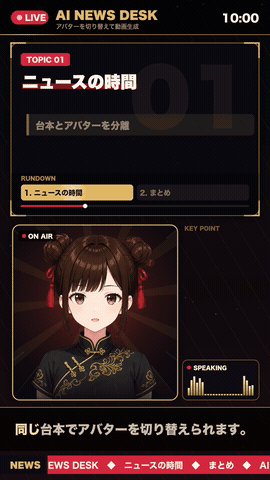
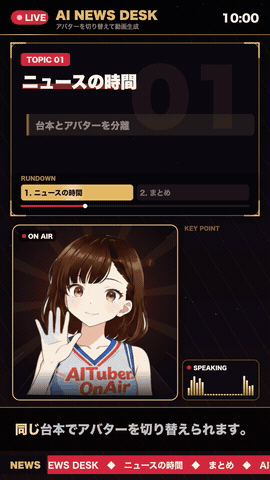
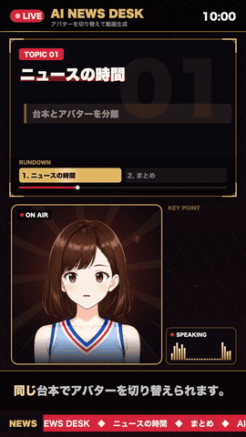
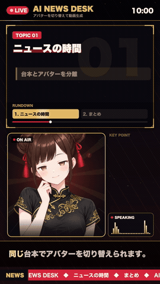
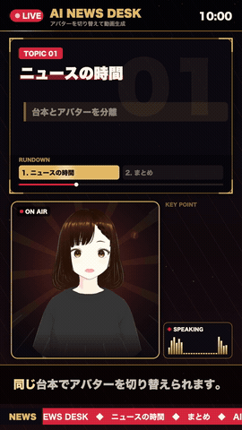
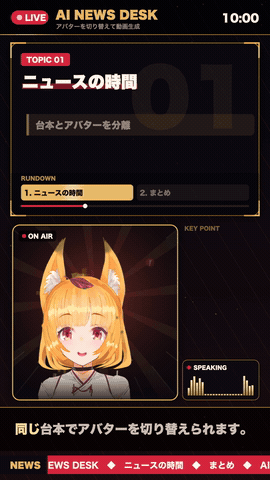

# Node Newsdesk

JSON台本から縦型ニュース動画を生成します。元の記事やメモから、AITuber OnAir Coreで台本を作ることもできます。同じ台本のまま、`--avatar`でPNGTuber・Purupuru・Mesh・VRM・Live2D・Inochi2D・PSDを切り替えられます。

[English](README.md)

## アバターギャラリー

`samples/hello-sine.json`から、発話・キーワード・感情効果が見える4秒間を抜き出しています。PSDモーションは下記のPSD設定にある、隣接サンプルのMiko PSDを使います。

| PNGTuber | Purupuru |
| --- | --- |
|  |  |
| **PSD（静止）** | **PSD（モーション）** |
|  |  |
| **Mesh** | **VRM** |
|  |  |
| **Inochi2D** | **Live2D** |
|  | 利用者がモデルとCubism Coreを用意する必要があります。[Live2Dのセットアップ](#live2d設定と必要ファイル)を参照してください。 |

## セットアップと動画生成

Node.js 22以降と、PATH上の`ffmpeg`が必要です。

```bash
npm install
npm run build
npm run gen -- --script samples/hello-sine.json --output work/pngtuber.mp4
npm run gen -- --script samples/hello-sine.json --avatar purupuru --output work/purupuru.mp4
npx playwright install chromium
npm run gen -- --script samples/hello-sine.json --avatar mesh --output work/mesh.mp4
npm run gen -- --script samples/hello-sine.json --avatar vrm --output work/vrm.mp4
npm run gen -- --script samples/hello-sine.json --avatar inochi2d --output work/inochi2d.mp4
npm run gen -- --script samples/hello-sine.json --avatar psd --output work/psd.mp4
```

サンプルの音声は決定的なサイン波で、APIキーは不要です。出力は1080 × 1920、30 fpsです。MP4と同じ場所に、ナレーションWAV・時刻情報JSON・描画設定JSONを保存します。アバターの初期値はPNGTuberです。

PNGTuberとPurupuruはNodeのネイティブCanvas2Dで描画し、Playwrightの読み込みやChromiumの起動を行いません。MeshはWebGLアバターと共通のCanvas2D画面をヘッドレスChromium内で描画します。上記のChromiumインストールはMesh・VRM・Live2D・Inochi2D・PSDのauto/motionモードで必要です。PSDのstaticモードを明示すると、ChromiumなしでNode描画を使います。VRMは隣接する`react-vrm-app/public/avatar/miko.vrm`と`idle_loop.vrma`を初期アセットとして使います。Live2Dは利用者がモデルとCubism Coreのパスを指定します（下記参照）。Inochi2Dは隣接する`react-inochi2d-app/public/inochi2d`のruntime・Akaモデル・モーションを使います。ブラウザアダプターは共通画面をページ内で描画します。

画面にはニュースパネル、章の進行表示、キーワード、感情に合わせた効果、カラオケ字幕、ティッカー、開始・終了タイトルが表示されます。PNGTuberは口・目の4状態と呼吸・傾き、Purupuruは口の3状態と瞬き・呼吸・傾き・髪の揺れに対応します。この2種類の表情画像は元のままで、台詞の感情は画面効果に反映されます。

Meshは表情と予定された動作にも対応します。隣接する`react-mesh-avatar-app`のフレームワーク非依存エンジンとqipaoアセットを読み取り専用で利用するため、そのディレクトリが必要です。VRMは音声RMSによる口パク、seedに基づく瞬き、VRMAアニメーション、モデルが持つ感情表情に対応します。未対応の感情は通常の表情で表示し、画面の名前付き動作は選択したVRMAループを置き換えません。

Live2Dは音声RMSによる口パク、seedに基づく瞬き、固定したIdleモーションに対応し、撮影前にモデルを安定させます。台詞の感情と名前付き動作は共通画面に反映し、モデルは選択したIdleを続けます。Inochi2Dは未改変のWASMブリッジで、音声RMSの口パク、seedに基づく瞬き、idleループを描画します。台詞の感情と名前付き動作は共通画面に反映します。
PSDはNodeでPSDTool形式の口・目レイヤーを切り替え、ChromiumではAnime2.5DRigのモーションを描画します。autoモードはリグを判定し、不適合なら静止描画に戻ります。台詞の感情と名前付き動作は共通画面に反映します。

## アバター設定

設定は台本とは別のJSONに書き、`--avatar-config avatar.json`で指定します。台本にはアバター設定を含めません。

```json
{
  "model": "assets/my-avatar",
  "scale": 1,
  "x": 0.5,
  "y": 0.5,
  "intensity": 1
}
```

`model`は設定ファイルからの相対パスです。PNGTuberでは4枚のPNGを持つディレクトリ、Purupuruでは`.purupuru`ファイル、Meshでは`manifest.json`を持つアセットディレクトリ、VRMでは`.vrm`、Live2Dでは`.model3.json`、Inochi2Dでは`.inx`、PSDでは`.psd`を指定します。PNGTuber・Purupuru・Mesh・VRMでは省略すると初期のMikoアセットを使います。Live2DはモデルとCoreのパスを明示する必要があります。Inochi2Dは隣接する`react-inochi2d-app/public/inochi2d`のAkaモデル・モーション・runtimeを初期値として参照します。PSDの初期値は同梱の`assets/sample-static.psd`と`mode: "auto"`です。

`scale`は0.1〜3、`x`と`y`は660 × 700のアバター枠内の位置（0〜1）、`intensity`は0〜3です。不明な項目や不正な値はエラーになります。検証と初期値は各アダプターで定義しています。Meshは`intensity`の代わりに`padTop`・`padSide`・`talkGain`を受け取ります。

| アバター | 初期配置 | 固有設定 |
| --- | --- | --- |
| PNGTuber | `scale: 1`, `x: 0.5`, `y: 0.5` | `intensity: 1`（0〜3） |
| Purupuru | `scale: 1.5`, `x: 0.5`, `y: 0.65` | `intensity: 1`（0〜3） |
| VRM | `scale: 1`, `x: 0.5`, `y: 0.5` | `animation`、`intensity: 1`（0〜3）、`framing`、`lighting`（下記参照） |
| Live2D | `scale: 1`, `x: 0.5`, `y: 0.5` | `cubismCore`、`intensity: 1`（0〜3）、`framing`、`idleMotionGroup`、`warmupSeconds: 3`（0〜30） |
| Inochi2D | `scale: 1`, `x: 0.5`, `y: 0.5` | `runtime`・`motion`・`idleAnimation`・`intensity: 1`（0〜3）・`framing`（下記参照） |
| PSD | `scale: 1`, `x: 0.5`, `y: 0.5` | `mode: "auto"`・`roles`・`intensity: 1`（0〜3、motionでは2まで）・motion用`framing`（下記参照） |
| Mesh | `scale: 1`, `x: 0.5`, `y: 0.5` | `padTop: -0.07`（-0.5〜1）、`padSide: -0.18`（-0.45〜1）、`talkGain: 0.55`（0〜3） |

Purupuruは上半身を大きく表示します。Meshのpaddingは元画像の切り取り範囲、`talkGain`は音声に伴う体の動きの強さを調整します。

```json
{ "padTop": -0.07, "padSide": -0.18, "talkGain": 0.55 }
```

### VRM設定

```json
{
  "model": "avatar/miko.vrm",
  "animation": "avatar/idle_loop.vrma",
  "intensity": 1,
  "framing": { "visibleHeightRatio": 0.32, "lookAtHeightRatio": 0.84 },
  "lighting": { "ambientIntensity": 1.4, "directionalIntensity": 2.35 }
}
```

`animation`は設定ファイルからの相対パスです。省略すると初期のidleループを使い、`null`にするとアニメーションを読み込みません。`intensity`はアニメーションと物理演算の時計を0〜3倍に調整します。0ではポーズを固定し、口パクと瞬きは続けます。

`framing.visibleHeightRatio`はズーム（0.05〜2、小さいほど寄る）、`lookAtHeightRatio`はカメラが向く高さ（0〜1.5、小さいほどモデルが上へ移動）を指定します。カメラ設定の後に、アバター枠内のscaleと位置を適用します。環境光・指向性ライトの強さはそれぞれ0〜10です。

初期の構図は、頭部と上半身が共通のアバター枠を満たすように調整しています。光量単位、腰の移動を除く処理、固定時間刻みは旧VRMレンダラーを引き継いでいます。描画ライブラリはthree.js `0.182.0`、`@pixiv/three-vrm` `3.4.5`、`@pixiv/three-vrm-animation` `3.4.5`に固定しています。

### Live2D設定と必要ファイル

利用許諾を確認したCubism 4の`.model3.json`と参照先一式、ローカルの`live2dcubismcore.min.js`が必要です。このサンプルはCoreもLive2Dモデルも同梱・ダウンロードしません。[Live2D公式ダウンロードページ](https://www.live2d.com/sdk/download/web/)から、使用許諾を確認・同意したうえでCubism SDK for Webを取得し、`Core/live2dcubismcore.min.js`を使います。Coreを直リンクしないでください。

台本とは別に設定を保存します。例えば`work/live2d.json`に次を書き、手元のファイルパスへ置き換えます。

```json
{
  "model": "/path/to/model/runtime/model.model3.json",
  "cubismCore": "/path/to/CubismSdkForWeb/Core/live2dcubismcore.min.js",
  "framing": { "scale": 2.5, "x": 0.5, "y": 0.4 },
  "idleMotionGroup": "Idle",
  "warmupSeconds": 3,
  "intensity": 1
}
```

```bash
npm run gen -- --script samples/hello-sine.json --avatar live2d \
  --avatar-config work/live2d.json --output work/live2d.mp4
```

パスは設定ファイル相対、絶対パス、`~/`始まりを使えます。隣接する`react-live2d-app/public/scripts/`に既存のCoreがある場合は、明示的なパスで参照できます。そのドロップはgitignore済みです。必要なファイルはこのサンプルの外に保管し、設定から参照してください。Coreまたはモデルがなければ、Chromiumを起動する前にエラーを返します。

`framing`は共通のscale・位置を適用する前のモデル変換です。バストアップの初期値は`scale: 2.5`・`x: 0.5`・`y: 0.4`で、scaleは0.1〜5、xとyは0〜1を受け付けます。`idleMotionGroup`は初回と再開時のモーションをindex 0に固定します。省略または`null`では、存在する`Idle`を使います。

`warmupSeconds`はフレーム0より前に撮影せずモデルを更新する時間です。動画のフレーム数は増やしません。`intensity`は撮影開始後のアニメーション速度を0〜3倍にし、0では安定したポーズを固定します。口パクとseedに基づく瞬きは続けます。

ページは利用者指定のCoreを先に読み、Cubism 4レンダラーを読み込みます。PixiJSと表示プラグインはLive2D選択時だけ読み込みます。依存は旧Live2Dサンプルと同じPixiJS `^7.4.3`と、`pixi-live2d-display-lipsyncpatch`の`release/v0.5.0-ls-7-noMaskFix`です。ループバックサーバーはハーネス、指定Core、モデルの親ディレクトリ以下を配信し、パストラバーサルとシンボリックリンクによる脱出を拒否します。

Live2D公式サンプルモデルで作った動画を公開する場合は、[無償提供マテリアルの使用許諾契約書](https://www.live2d.com/eula/live2d-free-material-license-agreement.html)と[Live2D Cubismサンプルデータ利用条件](https://www.live2d.com/eula/live2d-sample-model-terms.html)の両方を確認し、利用者・事業者区分の条件や必要な著作権表示に従ってください。

### Inochi2D設定

初期値は`react-inochi2d-app/public/inochi2d`のruntime、`Aka.original-rig.inx`、`Aka.original.motion.json`を読み取り専用で参照します。モデルやruntimeはコピー・ダウンロードしません。隣接するディレクトリを保持するか、設定ファイル相対・絶対パス・`~/`始まりのパスを指定してください。

```json
{
  "model": "models/avatar.inx",
  "runtime": "runtime",
  "motion": "models/avatar.motion.json",
  "idleAnimation": "original_idle_calm_breath",
  "intensity": 1,
  "framing": { "scale": 0.4, "x": 0, "y": 1800 }
}
```

`runtime`には`inochi_bridge.js`・`inochi2d.js`・`inochi2d_bg.wasm`・`secondary_motion.js`が必要です。runtime・モデル・モーションがなければChromium起動前にエラーを返します。`motion: null`で外部モーションを読み込まず、`idleAnimation: null`でidleループの開始を省略します。`intensity`は旧レンダラーと同じidleの重み（0〜3）で、速度は変えません。0でもブリッジの二次物理演算は続きます。

`framing`は共通のscale・位置を適用する前のカメラ変換です。scaleは0.05〜2、xとyはモデル空間のピクセル単位（-10000〜10000）です。初期値は`scale: 0.4`・`x: 0`・`y: 1800`で、耳を含む頭部と上半身が共通枠に収まる構図です。旧版の全画面表示は0.65・0・1450でした。

ブリッジをimportする前に、rAFキュー・`performance.now()`・`Date.now()`・`Math.random()`をseedに基づく仮想時計へ置き換えます。各フレームで`1 / 30`秒だけ進め、ブリッジを1回更新して次フレームの予約が1件であることを確認します。更新中に予約されたrAFは次フレームまで待ちます。口は`Mouth:: Shape`のvec2、瞬きは`setEyeBlinkValue`を優先し、終了時には元の時計APIへ戻します。

### PSDの静止・モーション描画

同梱の静止サンプルを使う場合は、`work/psd-static.json`に次を保存します。

```json
{ "mode": "static", "intensity": 1 }
```

```bash
npm run gen -- --script samples/hello-sine.json --avatar psd \
  --avatar-config work/psd-static.json --output work/psd-static.mp4
```

`mode: "static"`はNodeのPSDパーサーとCanvas2Dだけを読み込みます。初期値の`mode: "auto"`はChromiumでAnime2.5DRigの判定を行い、不適合ならChromiumを閉じて静止描画へ戻ります。`mode: "motion"`で適合するリグが見つからなければ、判定理由をエラーとして返します。同梱サンプルはPSDTool形式のため、autoでも静止描画になります。

静止モードはPSDToolの`!`による強制表示、`*`によるラジオグループ、下から上への合成、親から引き継ぐ不透明度を維持します。口・目の役割は日本語・英語のレイヤー名から判定し、`roles`でピクセルレイヤーへの正確なパスを指定できます。

```json
{
  "mode": "static",
  "model": "avatar.psd",
  "roles": {
    "mouthOpen": "Face/Mouth/Open",
    "mouthClosed": "Face/Mouth/Closed",
    "eyesOpen": "Face/Eyes/Open",
    "eyesClosed": "Face/Eyes/Closed"
  }
}
```

役割を解決できない場合はレイヤーツリーを表示します。口は音声RMS 0.45を境に切り替え、目はseedに基づく瞬きで切り替えます。`intensity`は呼吸と傾きを0〜3倍にし、0ではその動きを止めます。同梱サンプルの口・目は差分領域だけのレイヤーなので、それぞれ独立して切り替わります。

静止モードは通常のピクセルレイヤーを持つ8-bit RGB PSDを対象にしています。PSB、クリッピング、マスク、効果、`.faview`、`:flip*`変換は未対応です。通常以外の合成モードは通常のアルファ合成で描画します。`:flip*`名は解析しますが変換せず、レイヤーの未対応機能は診断情報に記録します。

モーションは隣接する既存のMiko PSDをコピーせず参照できます。`work/psd-motion.json`に次を保存します。

```json
{
  "model": "../../react-psd-app/public/avatar/miko-anime25drig-cheer.psd",
  "mode": "auto",
  "intensity": 0.6,
  "framing": { "scale": 2, "x": 0.5, "y": 0.8 }
}
```

```bash
npm run gen -- --script samples/hello-sine.json --avatar psd \
  --avatar-config work/psd-motion.json --output work/psd-motion.mp4
```

パスは設定ファイル相対、絶対パス、`~/`始まりを指定できます。モーションは隣接する既存のリガーとAnime2.5DRigレンダラーを読み取り専用で参照します。読み込む前にseedに基づく仮想時計を設定し、各フレームで`mouthOpen`入力、固定時間の進行、1回のrAF更新を行います。モーションの`intensity`は旧レンダラーの0〜2へ制限します。目の開閉を直接設定するAPIはないため、時刻と乱数を固定した内蔵の瞬きを維持します。`roles`は静止モードで使います。

モーション用`framing`は共通のscale・位置より先に元キャンバスを変換し、静止モードでは使いません。初期値の`scale: 2`・`x: 0.5`・`y: 0.8`は隣接サンプルの上半身を表示する構図です。scaleは0.1〜3、xとyは0〜1です。元キャンバス全体を収める場合は`scale: 1`・`x: 0.5`・`y: 0.5`を指定します。

## 台本生成

```bash
npm run script-gen -- notes.md --output work/script.json --dry-run
npm run script-gen -- notes.md --output work/script.json
npm run gen -- --script work/script.json --avatar purupuru --output work/news.mp4
```

初期プロバイダーはCoreの`codex-sdk`で、ローカルのCodexログインを使います。APIプロバイダーの`openai`・`claude`・`gemini`は、それぞれ`OPENAI_API_KEY`・`ANTHROPIC_API_KEY`・`GEMINI_API_KEY`環境変数を使います。生成時には台本のスキーマと、数値の主張が原文にあるかを検証します。[台本形式](docs/script-format.md)も参照してください。

音声エンジンは`sine`、macOSの`say`、`aituber-voice`です。`aituber-voice`は`voice.options`をCoreの`VoiceEngineAdapter`へ渡します。認証情報は台本に保存しないでください。

## フレーム確認とフォント

```bash
npm run gen -- --script samples/hello-sine.json --dry-run --output work/news.mp4
npm run gen -- --script samples/hello-sine.json --render-only --output work/news.mp4
npm run gen -- --script samples/hello-sine.json --frame 60 --png work/frame60.png
```

`--dry-run`は音声と時刻情報だけを生成します。`--render-only`はそれらを再利用し、`--avatar`と`--avatar-config`で今回の描画方法を選びます。ネイティブアダプターは指定フレームへ直接移動できます。ブラウザアダプターはフレーム0から再生して指定フレームを保存します。共通画面には音声履歴を明示的に渡し、Purupuruの物理演算は仮想時計で事前計算するため、フレームの描画順に結果が左右されません。

ネイティブCanvas2Dはシステムフォントを使います。macOSではヒラギノを利用できます。LinuxではNoto Sans JPまたはNoto Sans CJK JPをインストールし、認識されない場合は`NEWSDESK_FONT_PATH=/path/to/NotoSansJP.ttf`を指定してください。Chromiumにも日本語対応のシステムフォントが必要です。`NEWSDESK_FONT_PATH`はネイティブCanvas2Dにのみ適用されます。

## アセットと利用条件

| アバター | アセット | 利用条件 | クレジット |
| --- | --- | --- | --- |
| PNGTuber | 同梱のMiko 4状態PNG | [Miko利用条件](MIKO_ASSET_TERMS.md) | © Yuki Shindo (AITuber OnAir) |
| Purupuru | 同梱の`miko.purupuru` | [Miko利用条件](MIKO_ASSET_TERMS.md) | © Yuki Shindo (AITuber OnAir) |
| VRM | 隣接する`react-vrm-app/public/avatar/miko.vrm` | [Miko利用条件](MIKO_ASSET_TERMS.md) | © Yuki Shindo (AITuber OnAir) |
| Mesh | 隣接する`react-mesh-avatar-app/public/avatar/qipao` | [Miko利用条件](MIKO_ASSET_TERMS.md) | © Yuki Shindo (AITuber OnAir) |
| Inochi2D | 隣接する派生Akaモデル・モーション | [CC BY 4.0](https://creativecommons.org/licenses/by/4.0/) | Aka / seagetch（下記参照） |
| PSD static | 同梱のMiko由来`sample-static.psd` | [Miko利用条件](MIKO_ASSET_TERMS.md) | © Yuki Shindo (AITuber OnAir) |
| PSD motion | 隣接する`react-psd-app/public/avatar/miko-anime25drig-cheer.psd` | [Miko利用条件](MIKO_ASSET_TERMS.md) | © Yuki Shindo (AITuber OnAir) |

MikoはAITuber OnAirの公式キャラクターです。[Mikoキャラクター利用ガイドライン](https://miko.aituberonair.com/#terms)の日本語版を正式な利用条件として参照してください。初期VRMAループは`react-vrm-app`が[`pixiv/ChatVRM`](https://github.com/pixiv/ChatVRM)のアセットから流用したものです。アニメーション自体を再配布する場合は、そのライセンスを確認してください。隣接するモデルとアニメーションは、このサンプル内には複製していません。

## Aka のクレジット

この例は `react-inochi2d-app` に同梱された派生 Aka ファイルを参照します。

- Title: Aka
- Author: seagetch
- Source: https://github.com/Inochi2D/example-models
- License: Creative Commons Attribution 4.0 International
- License URL: https://creativecommons.org/licenses/by/4.0/

参照ファイルは `Aka.original-rig.inx` と `Aka.original.motion.json` です。
この同梱版は AITuber OnAir Inochi2D 例向けに調整されています。変更点は、
ブラウザ描画向け rig 調整、アバター動作用 helper rig、idle motion の調整、
`public/inochi2d/manifest.json` による motion metadata 設定です。元モデルの
クレジットとライセンスは sibling の `Aka.ATTRIBUTION.md` に保持されています。

## Anime2.5DRig のクレジット

Anime2.5DRig 互換 auto-rigging と renderer のクレジットは次のとおりです。

- Project: [Anime2.5DRig](https://github.com/852wa/Anime2.5DRig)
- Author: 852wa (hakoniwa)
- Copyright: Copyright (c) 2026 hakoniwa
- License: MIT License
- Upstream commit: `d48825867acd081de22b0e7b5585bb562288796d`

この example は vendored sibling rigger と renderer を read-only で import し、
コピーしません。sibling のミコPSDには、下記の素材利用条件が適用されます。

同梱のミコ由来 PSD アバターの著作権表記は © Yuki Shindo (AITuber OnAir) です。
このアバターはリポジトリの MIT License 対象外です。作品・コンテンツの一部
として一体で再配布できますが、素材単体・素材集としての再配布は禁止です。
正式な日本語ガイドラインへのリンクは
[Miko Asset Terms](./MIKO_ASSET_TERMS.md)を参照してください。

## 開発時の確認

```bash
npm run fmt
npm run lint
npm run typecheck
npm run test
npm run build
```
