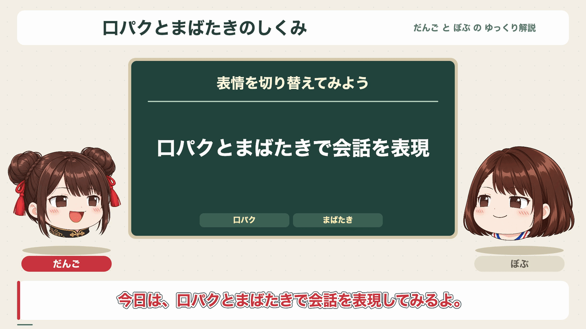

# ゆっくり解説動画サンプル (Node)

<p align="center">
  
</p>

JSON台本と2人分の透過画像セットから、1920×1080・30fpsのMP4を生成します。
人物ごとに音声と字幕の色を設定でき、話している人物は一定の間隔で口を開閉し、
音量に合わせて小さく跳ねます。聞いている人物は口を閉じて呼吸するように動き、
まばたきは2人それぞれ別のタイミングで行います。

[English](./README.md)

## 実行

Node.js 22以上、PATHの通ったffmpeg、日本語フォントが必要です。
日本語フォントがない環境では、Noto Sans JPなどのフォントファイルを
`YUKKURI_FONT_PATH` で指定してください。

リポジトリのルートで、依存するCoreを先にビルドします。

```bash
npm ci
npm run build
cd packages/core/examples/node-yukkuri-explainer
npm ci
npm run build
npm run gen -- samples/yukkuri-hello-sine.json --out work/hello.mp4
```

サイン波サンプルは人物ごとに高さの異なるテスト音を鳴らします。
日本語の読み上げは行わず、音声サーバーやAPIキーは不要です。
MP4とともに、結合済みWAV、せりふの開始・終了時刻、描画設定を保存します。
出力先の `work/` はGit管理外です。

## aqtpserverでAquesTalkPlayerを使う

インストール済みのAquesTalkPlayerと
[aqtpserver](https://github.com/shinshin86/aqtpserver)を起動してから実行します。

```bash
npm run gen -- samples/yukkuri-hello-aqtp.json --out work/aqtp.mp4
```

各人物の `voice.engine` を `aituber-voice` にすると、`voice.options` が
Coreの `VoiceEngineAdapter` に渡されます。

```json
{
  "engineType": "openaiCompatible",
  "openAiCompatibleApiUrl": "http://127.0.0.1:20203/v1/audio/speech",
  "openAiCompatibleModel": "aquestalkplayer",
  "speaker": "れいむ",
  "openAiCompatibleResponseFormat": "wav"
}
```

サンプルでは、だんごに「れいむ」、ぼぶに「まりさ」を指定しています。
別のアドレスで起動している場合は、両者の `openAiCompatibleApiUrl` を
音声生成エンドポイントの完全なURLに変更してください。
プリセット名はAquesTalkPlayerに登録されているものを使います。
速度とピッチはプリセットに従い、Instructionsは使えません。
導入手順と利用条件は [Local TTS](../../../../docs/local-tts.md#aquestalkplayer-aqtpserver)
を参照してください。接続に失敗した場合は処理を止め、対象の行と話者を表示します。

## 台本の形式

`speakers` に2人を登録し、`position` をそれぞれ `left` と `right` にします。
各人物には `name`、`image`、`position`、`subtitleColor` (`#rrggbb`)、
`voice` (`engine` と任意の `options`) が必要です。
`mirror: true` で画像を左右反転できます。

`image` には `"../assets/yukkuri/dango"` のように、台本から見た画像フォルダの
パスを指定します。フォルダには同じ大きさのPNGを4枚入れます。

```text
mouth_close_eyes_open.png
mouth_open_eyes_open.png
mouth_close_eyes_close.png
mouth_open_eyes_close.png
```

4つのファイル名から `.png` を除いた名前をキーにし、それぞれのパスを値にした
オブジェクトでも指定できます。人物の位置と透過キャンバスをそろえてください。
画像サイズが一致しない場合はエラーになります。従来の単一PNGの指定は、
画像フォルダまたは4ファイルの指定に置き換える必要があります。

次の設定は台本全体に指定でき、人物ごとの設定で上書きできます。

| 設定 | 初期値 | 動作 |
| --- | --- | --- |
| `mouthMode` | `"flap"` | `"flap"` は一定間隔で開閉、`"rms"` は音量が閾値以上のときに開きます。 |
| `flapInterval` | `0.12` | 口を開く・閉じる各状態の秒数。1/30〜1秒で指定します。 |
| `mouthThreshold` | `0.08` | 正規化した音量の閾値。0より大きく1以下で指定します。無音中は口を閉じます。 |
| `motion` | `"subtle"` | `"subtle"` は小さな跳ね、`"bounce"` は従来の大きな跳ね、`"none"` は体の動きを止めます。 |

まばたきは聞いている間も行い、約2〜6秒おきに0.1〜0.2秒間目を閉じます。
`motion: "none"` でも口パクとまばたきは続きます。

各行には `speaker` (`speakers` のキー) と `text` を指定します。
未登録の話者がある台本は、音声生成前にエラーになります。
任意で次の項目も指定できます。

- `reading`: 読み上げに使う文字列。省略すると `text` を読みます。
- `chapter`、`point`: 中央パネルの見出しと説明。次の指定まで表示を保ちます。
  章が変わると前の説明とスライドを消します。
- `keywords`: 短いラベルを3つまで指定します。
- `slide`: `{ "text": "短い説明" }` または `{ "image": "../assets/slide.png" }`。
- `emotion`: `neutral`、`happy`、`surprised`、`sad`、`angry`、`relaxed`。
  ジャンプの強さに反映します。
- `pauseAfter`: その行の後に入れる無音の秒数。
- `spoken: false` と正の `duration`: 指定した秒数だけ、音声なしで字幕を表示します。

台本全体には `show` (`title`、`subtitle`)、`seed`、`leadIn`、`leadOut`、
`defaultPauseAfter`、`output` を設定できます。
画像・スライド・台本内の出力先はJSONファイルからの相対パスです。
`--out` / `--output` と `--png` は、コマンドを実行したディレクトリからの相対パスです。
8行の会話例は [サイン波サンプル](./samples/yukkuri-hello-sine.json) を参照してください。
字幕は1行の台本につき100文字までで、字幕欄に収まるように折り返し・縮小します。

## プレビューと確認

```bash
# 動画を出力せず、音声と時刻情報を生成する
npm run gen -- samples/yukkuri-hello-sine.json --out work/hello.mp4 --dry-run
# 生成済み音声・設定を使い、30番目のフレームを保存する (0始まり・30fps)
npm run gen -- samples/yukkuri-hello-sine.json --out work/hello.mp4 --render-only --frame 30 --png work/frame.png
# 音声を再生成せずに動画を書き出す
npm run gen -- samples/yukkuri-hello-sine.json --out work/hello.mp4 --render-only
npm run fmt
npm run build
npm run test
npm run lint
```

`--render-only` は保存済みの設定を使います。台本を変更した場合は、このフラグを
付けずに再生成してください。`--keep-temp` を付けると各行のWAVも残せます。
動きは固定の時間刻みとシードで計算するため、途中のフレームを取り出しても、
最初から生成しても同じ姿勢になります。画素単位で同じ画像を得るには、
フォントと描画ライブラリのバージョンもそろえる必要があります。
LLMによる台本生成や、ほかのアバター形式は含みません。

### Chat 0.71.0

Core 0.26.30は公開済みのChat 0.71.0とVoice 0.30.0を利用します。
Gemini 4モデル（現在はArgon・Carbon・Hydrogen）は画像入力に対応する明示選択肢で、思考は必須です。
`low`（パッケージの初期値）・`medium`・`high`を選べます。プロバイダーの初期モデルは変わりません。
Hydrogen（`gemini-4-hydrogen`、OpenRouterでは`google/gemini-4-hydrogen`）は、
直接Gemini APIのレート制限付き無料枠で利用できます。OpenRouter版は有料です。
Google側の初期値は`high`です。追加の`xhigh`はGenerateContent RESTの列挙値の表記が公開されていないため選択肢に含めていません。
Argon・Carbonは有料枠が必要で、Google側の初期値は`medium`です。
CarbonはArgonより思考トークンを多く使い、応答時間とトークン使用量が増えます。

思考も出力上限に含まれます。Gemini 4の暗黙の上限はOpenRouter版も含め最低32,768トークンです。
直接Gemini APIで明示した上限はモデル別に制限されます。
Argon・Carbonは非ストリーミング32,768／ストリーミング65,536、Hydrogenは両方式とも65,536です。
それより小さな明示上限は保持します。短い返答はプロンプトでも指定してください。
long decodeと自動継続生成は実装していません。

追加のOpenRouterモデルはテキスト・画像入力、ツール、ストリーミングに対応します。既定モデルは変更していません。

| モデルID | 推論レベル（パッケージ初期値） |
| --- | --- |
| `meta/muse-ember` | max, xhigh, high, medium, low, minimal（`minimal`） |
| `thinkingmachines/inkling-2-small` | max, high, medium, low, minimal（`minimal`） |
| `nex-agi/nex-n2.6` | high, medium（`medium`）。思考は無効化できません |
| `inclusionai/ling-3.2-flash:free` | 推論レベルの選択なし。プロバイダー既定を使用 |

これらのモデルに推論トークン予算は設定できません。Lingは`:free`付きの正確なIDを使い、
`includeReasoning`による表示設定は維持します。音声・動画・ファイル入力は追加していません。
詳しくは[Chatのドキュメント](../../../chat/README.ja.md)を参照してください。
