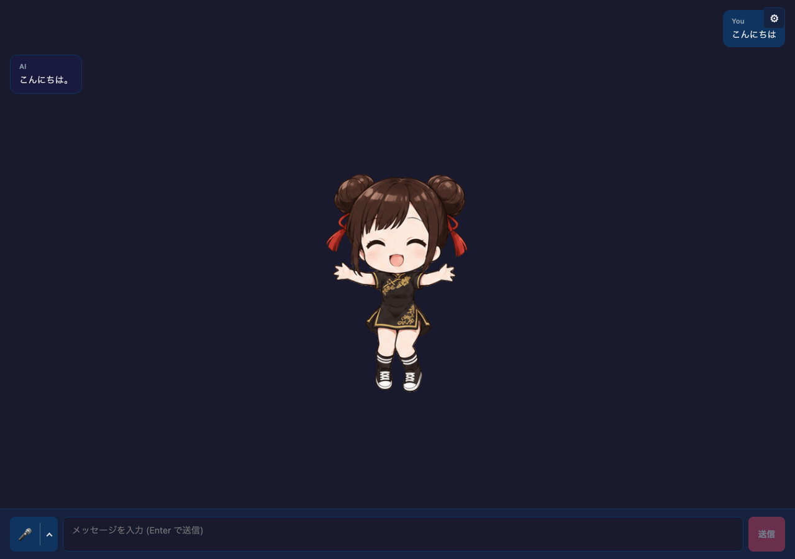

# Media Avatar Chat

### Chat 0.69.0

Core 0.26.28は公開済みのChat 0.69.0とVoice 0.30.0を利用します。
Claude Fable 5.2（`claude-fable-5-2`、OpenRouterでは`anthropic/claude-fable-5.2`）、
Gemini 4 Argon（`gemini-4-argon`、OpenRouterでは`google/gemini-4-argon`）、
Mistral版GLM-5.3 Flash（`zai-glm-5-3-flash`）を明示選択できます。いずれも画像入力に対応し、
effort初期値は会話の応答時間を抑えるため`low`です。Fableはlow/medium/high/xhigh/max、
Argonはlow/medium/high、Mistral版GLM Flashはlow/high/maxに対応します。
Fableではツールを自動選択し、返された署名付きthinkingとその前の履歴を変更せず保持してください。
Argonは思考トークンも出力上限に含めます。暗黙の上限は32,768以上、明示上限も非ストリーミングで
32,768以上、ストリーミングで65,536以上に補正されます。短い返答が必要ならプロンプトで指定してください。

OpenRouterには有料・画像対応の`~openai/gpt-luna-latest`、`~openai/gpt-terra-latest`、
`~deepseek/deepseek-flash-latest`、`~z-ai/glm-flash-latest`、`xiaomi/mimo-v2.6-pro`、
`tencent/hy4`、`cohere/command-a-plus`、`bytedance-seed/seed-2-1-turbo`、
`nvidia/nemotron-3.5-super-vl`、`sakana/sakana-namazu`も追加されました。
Nemotronの無料版は別の選択肢として残ります。Namazuには出力トークン上限を送らないため、
responseLengthは厳密な上限になりません。未対応の推論レベルは選択肢に出しません。

新規設定には現在の対応モデル一覧を使い、DeepSeekのテキスト・画像モデルは`deepseek-flash`から始めます。
新たに非推奨となったOpenAI GPT-4o/GPT-4.1、Gemini 2.5 Pro/Flash、DeepSeek V4 Flash/Vision Exp、
Mistral Medium 3.5、OpenRouter Mercury 2.5/3・Kimi K2.5・GPT Latestは新規選択肢から除外します。
互換用の定数と保存済みIDは保持します。OpenRouterのカタログでも非推奨の行を隠し、保存済みの選択は保持します。
ほかのプロバイダーの既定モデルは変更しません。




このブラウザ例から API を直接呼び出せないプロバイダーは、選択を無効にしています。
現在は Sakana AI と Sarashina が該当します。Sarashina の API キーは保護された
バックエンドで管理し、Node.js などのサーバー環境から利用してください。

Core 0.26.28、Chat 0.69.0、Voice 0.30.0 を使用します。

`@aituber-onair/core` を使い、返答の感情に合わせて画像・GIF・動画を
切り替えるReactチャットサンプルです。

## 特徴

- PNG・JPG・JPEG・WebP・GIF・MP4・WebMに対応（各100 MBまで）
- neutral・happy・angry・sad・relaxed・surprisedに1ファイルずつ設定
- neutral・happy・angry・sadのGIFを同梱。relaxed・surprisedはneutralで代替
- GIF・ミュート動画をそのままループ再生
- アップロードをIndexedDBに保存し、再読み込み後に復元
- Single Image Avatarサンプルと同じLLM・TTS・配信・音声入力・Kizuna・感情エフェクト

## 音声入力

入力欄の左にあるマイクボタンで音声入力を始め、もう一度押すと止まります。
隣の `⌃` から聞き取り方と使うサービスを選べます。設定はブラウザに保存されます。

- 聞き取り方: **一回だけ** は一度話すと送信して終わります。**継続して会話**
  は返答の生成と読み上げが終わると、また聞き取ります
- 使うサービス: **ブラウザ**（Web Speech API）、**OpenAI**、**Gemini**。
  `@aituber-onair/transcription` を使い、話し終えて確定した文をそのまま送信します
- OpenAI と Gemini は LLM 設定と同じ API キーを使い、メニューからも入力できます。
  キーはブラウザから各サービスへ直接送られるため、共有端末では使わないでください。
  聞き取り中は利用料金がかかります
- OpenAI と Gemini は接続が済むまで声を受け付けません。マイクを押した直後は
  「接続しています」と表示され、話せる状態になると表示とボタンが切り替わります

## セットアップ

`openai-compatible` では、ローカルサーバーのプリセットを選ぶか、origin、
`/v1` ベース URL、`/chat/completions` の完全 URL を入力できます。モデル一覧を
取得してモデルを選び、チャット前に **Test connection** を実行してください。
詳しくは [ローカル LLM セットアップガイド](https://github.com/shinshin86/aituber-onair/blob/main/docs/local-llm.ja.md) を参照してください。

`OpenAI-Compatible TTS` では、origin、`/v1` ベース URL、`/audio/speech` の
完全 URL を入力できます。**Detect server** でサーバーが提供するモデルと voice の
一覧を取得し、**Test speech** で短い音声を再生して確認できます。
詳しくは [ローカル TTS セットアップガイド](https://github.com/shinshin86/aituber-onair/blob/main/docs/local-tts.ja.md) を参照してください。

```bash
cd packages/core/examples/react-media-avatar-app
npm install
npm run dev
```

起動後に **Settings → アバター** を開き、感情ごとにファイルを選択します。
動画はミュートでループ再生します。再生可能なコーデックはブラウザによって異なります。
各行には実際に表示されるメディアと「付属」「アップロード」の区別が表示されます。
「クリア」でその感情のアップロードを削除し、「すべてデフォルトに戻す」で全件削除します。

表示の優先順は、感情別のアップロード → アップロードしたneutral → 感情別の付属GIF →
付属のneutralです。アップロードがない場合は付属セットを使います。
未知の感情はneutralとして扱い、発話終了時もneutralに戻ります。
切り替え先の読み込み中は直前のメディアを表示し、再生できない場合はエラーを表示して
付属のneutralに戻ります。

ファイルはブラウザのIndexedDB（`react-media-avatar-app-media`）に保存し、再読み込み後に復元します。
その他の設定はlocalStorage（`react-media-avatar-app-settings`）に保存します。
ブラウザのサイトデータを削除すると、どちらも消えます。保存に失敗した場合はアバター設定に
エラーを表示し、直前の選択を維持します。アバター設定からファイルをサーバーへ送信することはありません。

LLM・TTS・配信の設定は「AI・音声・配信」タブにあります。
感情エフェクトを手動にすると、画面のボタンで感情を
プレビューでき、2.6秒後にneutralへ戻ります。感情エフェクトの重ね表示も引き続き使えます。
顔・目のエフェクト位置は「アンカー調整」でメディアの構図に合わせてください。

## マウス操作

アバター表示エリアでホイールを回すと、カーソル位置を中心に40〜300%で拡大・縮小できます。
ドラッグで移動し、ダブルクリックでサイズと位置を初期値に戻します。
画像・GIF・動画と感情エフェクトは一緒に拡大・移動します。サイズと位置は
localStorage（`react-media-avatar-app-view`）に保存し、再読み込み後に復元します。
チャットの操作部や設定画面では拡大・移動しません。
「アンカー調整」を閉じてから拡大・移動してください。

## 音声再生

TTSはCore標準の再生経路を使います。発話イベントに合わせて感情別のメディアを
表示し、発話終了時にneutralへ戻ります。画像は固定表示し、GIF・ミュート動画は
ファイル自体のアニメーションをループ再生します。

## 同梱メディア

`public/avatar/media/` の4種類のGIFは、AI画像生成（ChatGPT）で作成したものです。
このサンプルで使用するために同梱しています。
