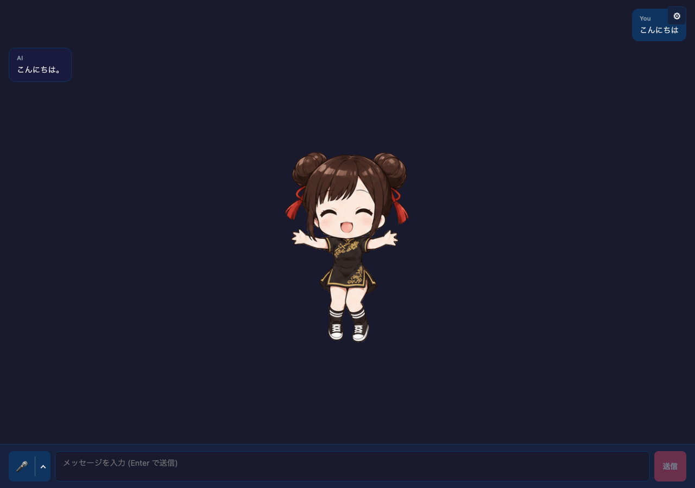

# Media Avatar Chat

### Chat 0.70.0

Core 0.26.29 uses published Chat 0.70.0 and Voice 0.30.0.
Gemini 4 models accept images and require thinking; currently these are Argon
and Carbon. Carbon (`gemini-4-carbon`, OpenRouter `google/gemini-4-carbon`)
is an explicit option with low/medium/high effort, defaulting to low
(Google default: medium). Carbon uses more thinking tokens than Argon, so
expect higher latency and token usage. It is not available on the Gemini API
free tier. Provider default models are unchanged.

Claude Fable 5.2
(`claude-fable-5-2`, OpenRouter `anthropic/claude-fable-5.2`), Gemini 4 Argon
(`gemini-4-argon`, OpenRouter `google/gemini-4-argon`), and Mistral-hosted
GLM-5.3 Flash (`zai-glm-5-3-flash`) are explicit image-capable options.
Fable and Argon support low/medium/high effort; Fable also supports xhigh/max.
Mistral GLM Flash supports low/high/max. All three start at low for responsive
chat. Fable keeps automatic tool selection and requires preserving signed
thinking with its preceding history unchanged. Gemini 4 counts thinking against
its output cap: implicit caps start at 32,768 tokens, and explicit caps cannot
exceed 32,768 (non-streaming) or 65,536 (streaming). Ask for short replies
in the prompt.

OpenRouter also adds the paid image-capable options `~openai/gpt-luna-latest`,
`~openai/gpt-terra-latest`, `~deepseek/deepseek-flash-latest`,
`~z-ai/glm-flash-latest`, `xiaomi/mimo-v2.6-pro`, `tencent/hy4`,
`cohere/command-a-plus`, `bytedance-seed/seed-2-1-turbo`,
`nvidia/nemotron-3.5-super-vl`, and `sakana/sakana-namazu`. The Nemotron free
route remains separate. Namazu omits output-token limits; responseLength is
not a hard cap for that route. Unsupported reasoning levels are not exposed.

New configurations use the current supported lists; DeepSeek now starts at
`deepseek-flash` for text and vision. Newly retired OpenAI GPT-4o/GPT-4.1,
Gemini 2.5 Pro/Flash, DeepSeek V4 Flash/Vision Exp, Mistral Medium 3.5, and
OpenRouter Mercury 2.5/3, Kimi K2.5, and GPT Latest are excluded from new
selection. Their exported constants and saved IDs remain compatible. The
OpenRouter picker hides deprecated catalog rows while retaining a saved
selection. Other provider defaults are unchanged.




Providers whose APIs must not be called directly from this browser example are
shown disabled: currently Sakana AI and Sarashina. Sarashina API keys must stay
on a protected backend; use a Node/backend integration.

Core 0.26.29 uses Chat 0.70.0 and Voice 0.30.0.

A React chat example built with `@aituber-onair/core`. Display an image,
animated GIF, or looping muted video for each response emotion.

## Features

- PNG, JPG, JPEG, WebP, GIF, MP4 and WebM files, up to 100 MB each
- One file for each of neutral, happy, angry, sad, relaxed and surprised
- Bundled neutral, happy, angry and sad GIFs; relaxed and surprised use neutral
- GIFs and muted videos loop in place
- Uploaded files saved in IndexedDB and restored after reload
- The same LLM, TTS, streaming, voice-input, Kizuna and emotion-effect controls
  as the Single Image Avatar example

## Voice input

Press the microphone button on the left of the chat form to start voice input,
and press it again to stop. The `⌃` button next to it opens the listening mode
and service options. The choices are saved in the browser.

- Listening mode: **一回だけ** (once) sends one utterance and stops.
  **継続して会話** (continuous) listens again after the reply has been generated
  and spoken
- Service: **ブラウザ** (Web Speech API), **OpenAI**, **Gemini**, or
  **ローカルサーバー（OpenAI 互換）** (local server). The example
  uses `@aituber-onair/transcription` and sends each confirmed utterance as a
  chat message
- OpenAI and Gemini use the same API keys as the LLM settings, and the keys can
  also be entered from the menu. Keys are sent from the browser directly to each
  service, so avoid shared devices. Listening is billed by each service
- OpenAI and Gemini do not accept audio until the connection is ready. Right
  after pressing the microphone the form shows a connecting status, and the
  button changes once you can speak

For a server that accepts multipart `POST /v1/audio/transcriptions` and returns
JSON with a `text` string, select **ローカルサーバー（OpenAI 互換）** in the mic
menu. Enter **サーバー URL** as an origin, a `/v1` base, or a full endpoint, and
check the displayed request URL. The URL starts empty. **モデル（任意）** and
**API キー（任意）** can stay blank unless the server requires them. These
settings, including the local key, are saved separately from the LLM keys in
this browser. Audio and any key go to that URL; use a server you trust.

Presets list only verified servers; pull requests for additional presets are
welcome. The **speech.cpp** preset sets `http://127.0.0.1:8080`. For example, run
`speech serve reazonspeech-v2 --cors-origin <page-origin>`, replacing
`<page-origin>` with the Origin shown in the mic menu. Speak after the listening
indicator appears, then pause to send the final transcript as a chat message.
Local input sends final results only, with a `ja-JP` language hint. Both once
and continuous modes are supported. See the [local STT guide](../../../../docs/local-stt.md)
for server setup, CORS, HTTPS, and troubleshooting.

## Setup

For `openai-compatible`, choose a local-server preset or enter an origin, a
`/v1` base URL, or a full `/chat/completions` URL. Fetch the model list, select
a model, and run **Test connection** before chatting. See the
[Local LLM setup guide](https://github.com/shinshin86/aituber-onair/blob/main/docs/local-llm.md).

For `OpenAI-Compatible TTS`, enter an origin, a `/v1` base URL, or a full
`/audio/speech` URL. **Detect server** fills in the model and voice lists when
the server provides them, and **Test speech** plays a short sample. See the
[Local TTS setup guide](https://github.com/shinshin86/aituber-onair/blob/main/docs/local-tts.md).


```bash
cd packages/core/examples/react-media-avatar-app
npm install
npm run dev
```

Open **Settings → アバター** to choose a file for each emotion.
Videos autoplay, loop and stay muted; codec support depends on your browser.
Each row previews the resolved media and shows whether it is bundled or uploaded.
**クリア** removes that emotion's upload. **すべてデフォルトに戻す** removes all uploads.

Resolution order: the emotion's upload → uploaded neutral → bundled emotion →
bundled neutral. Without uploads, the bundled set is used as-is. Unknown emotions
use neutral, and the avatar returns to neutral when speech ends.
The display keeps the previous media while the next file loads; a decoding failure
shows an error and falls back to the bundled neutral GIF.

Uploads persist in this browser's IndexedDB (`react-media-avatar-app-media`).
Other settings use `localStorage` (`react-media-avatar-app-settings`). Clearing
browser site data removes both. Storage errors appear in the Avatar tab and retain
the previous selection. Files are not uploaded to a server by the avatar controls.

LLM, TTS and streaming settings are under **AI・音声・配信**.
Set emotion effects to manual to preview emotions with
the on-screen buttons; each preview returns to neutral after 2.6 seconds.
The effect overlay remains independently configurable.
Use the anchor editor to align face/eye effects with your media composition.

## Mouse controls

Over the avatar area, use the mouse wheel to zoom around the cursor (40–300%),
drag to move, and double-click to reset the size and position. Images, GIFs and
videos move together with their emotion effects. Size and position are saved in
`localStorage` (`react-media-avatar-app-view`) and restored after reload.
Chat controls and settings do not start gestures. Close the anchor editor before
zooming or moving the avatar.

## Speech playback

TTS uses the standard Core playback path. Speech events select the emotion media
and restore neutral when playback ends. Images stay in place, while GIFs and
muted videos play their own animation in a loop.

## Bundled media

The four GIFs in `public/avatar/media/` were generated with AI image generation
(ChatGPT) and are provided for use with this example.

## Provider configuration

Select **Deepgram Flux** for English/Japanese one-shot MP3 speech. Enter a
Deepgram API key and select a named voice from the public v2 catalog.
Refreshes preserve the selected voice and keep the previous list on empty or
failed responses. Optional Speed is 0.5–1.5 in 0.05 steps. Vite development and
preview proxy `/api/deepgram/v2/speak` and `/api/deepgram/v2/models` to Deepgram.
Production needs equivalent authenticated backend routes with API keys kept
server-side.

For **OpenRouter TTS**, choose a model, then select one of its catalog voices.
A voice from the previous model is never reused. The TTS API key field shares
the OpenRouter key from the LLM settings. Browser calls expose the key to the
page; deploy shared apps behind your own backend.

## OpenRouter model catalog

The sample reads `GET https://openrouter.ai/api/v1/models` without an API key or
generation probes. Search covers model IDs and names; filters distinguish zero
published price, paid, and unknown pricing. These labels do not guarantee
availability, account access, quotas, routing, or actual charges.

A fresh catalog replaces curated choices. Failed refreshes retain last-good
metadata with a warning; without metadata, curated and legacy IDs are clearly
unverified fallback choices. Refresh never changes the selected model or API
keys. Saved legacy probe results are treated only as IDs. Removed selections
block new generation invocations, and changed pricing requires explicit
acknowledgement. An invocation already inside an SDK retry or rate-limit wait
cannot be cancelled by a later catalog refresh.
Vision and advanced options require both catalog metadata and SDK support.
Unknown dynamic models keep advanced features off. SDK request defaults,
including the 5000-token limit and `reasoning.exclude=true`, still apply and can
exceed a model's limits; this sample does not modify the public SDK registry.
