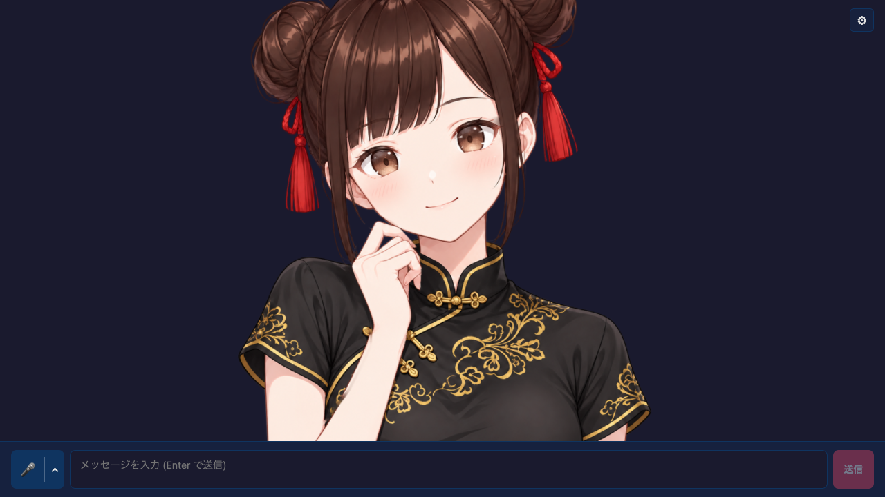

# Mesh Avatar Chat

### Chat 0.71.0

Core 0.26.30 uses published Chat 0.71.0 and Voice 0.30.0.
Gemini 4 models (currently Argon, Carbon, and Hydrogen) are explicit,
image-capable choices with mandatory thinking. Select `low` (package default),
`medium`, or `high`; provider default models are unchanged.
Hydrogen (`gemini-4-hydrogen`, OpenRouter `google/gemini-4-hydrogen`) is
available on the rate-limited direct Gemini API free tier; its OpenRouter route
is paid. Google defaults Hydrogen to `high`. Its additional `xhigh` level is
not exposed because the GenerateContent REST enum spelling is undocumented.
Argon and Carbon require the paid tier and default to `medium` upstream.
Carbon uses more thinking tokens than Argon, with higher latency and token use.

Thinking counts toward output limits. All Gemini 4 models keep an implicit
32,768-token floor, including on OpenRouter. For direct Gemini calls, explicit
limits are capped per model: Argon/Carbon at 32,768 non-streaming / 65,536
streaming; Hydrogen at 65,536 in both modes. Smaller explicit limits are
preserved. Request short replies in the prompt. Long decode and automatic
continuation are not implemented.

New OpenRouter text/image routes support tools and streaming without changing
the provider default:

| Model ID | Reasoning efforts (package default) |
| --- | --- |
| `meta/muse-ember` | max, xhigh, high, medium, low, minimal (`minimal`) |
| `thinkingmachines/inkling-2-small` | max, high, medium, low, minimal (`minimal`) |
| `nex-agi/nex-n2.6` | high, medium (`medium`); thinking cannot be disabled |
| `inclusionai/ling-3.2-flash:free` | No effort selector; provider default |

These routes expose no reasoning token-budget control. Ling uses its exact
`:free` ID and retains `includeReasoning` display control. Audio, video, and
file inputs are not added. See the [Chat documentation](../../../chat/README.md).

Claude Fable 5.2
(`claude-fable-5-2`, OpenRouter `anthropic/claude-fable-5.2`), Gemini 4 Argon
(`gemini-4-argon`, OpenRouter `google/gemini-4-argon`), and Mistral-hosted
GLM-5.3 Flash (`zai-glm-5-3-flash`) are explicit image-capable options.
Fable and Argon support low/medium/high effort; Fable also supports xhigh/max.
Mistral GLM Flash supports low/high/max. All three start at low for responsive
chat. Fable keeps automatic tool selection and requires preserving signed
thinking with its preceding history unchanged. Gemini 4 output budgets follow the per-model limits above.

OpenRouter also adds the paid image-capable options `~openai/gpt-luna-latest`,
`~openai/gpt-terra-latest`, `~deepseek/deepseek-flash-latest`,
`~z-ai/glm-flash-latest`, `xiaomi/mimo-v2.6-pro`, `tencent/hy4`,
`cohere/command-a-plus`, `bytedance-seed/seed-2-1-turbo`,
`nvidia/nemotron-3.5-super-vl`, and `sakana/sakana-namazu`. The Nemotron free
route remains separate. Namazu omits output-token limits; responseLength is
not a hard cap for that route. Unsupported reasoning levels are not exposed.

New configurations use the current supported lists; DeepSeek now starts at
`deepseek-flash` for text and vision. Newly retired OpenAI GPT-4o/GPT-4.1,
Gemini 2.5 Pro/Flash, DeepSeek V4 Flash/Vision Exp, Mistral Medium 3.5, and
OpenRouter Mercury 2.5/3, Kimi K2.5, and GPT Latest are excluded from new
selection. Their exported constants and saved IDs remain compatible. The
OpenRouter picker hides deprecated catalog rows while retaining a saved
selection. Other provider defaults are unchanged.


Providers whose APIs must not be called directly from this browser example are
shown disabled: currently Sakana AI and Sarashina. Sarashina API keys must stay
on a protected backend; use a Node/backend integration.

Core 0.26.30 uses published Chat 0.71.0 and Voice 0.30.0. Select
`deepseek-flash` for DeepSeek-V4.1-Flash-1017; this rolling API ID follows
provider updates. Fish Audio's Model selector includes `drama-3` and
`drama-3-preview` for one-shot, single-speaker speech. The preview may change;
`s2-pro` remains the default. Voice 0.27.0's empty-audio and Piper Plus model
input fixes are included; Piper Plus language selection is not exposed here.

[日本語 README](./README.ja.md)



A chat example built on `@aituber-onair/core` whose avatar is a single illustration animated
Live2D-style with WebGL2 mesh deformation. LLM, TTS, live comments and the broadcast layout are
the same as in `react-single-image-avatar-app`; only the avatar is replaced.

## Features

- The illustration is split into layers (body, hand, tassels, eye parts) that are deformed as meshes
- Head turn / tilt, breathing, blinking, gaze, brows, per-strand hair sway, tassel pendulums
- 12 idle motions and 9 reaction motions played at random while waiting
- Lip sync from the TTS audio level; while speaking, idle motions pause and the head nods along
- Emotion tags (`[happy]` `[sad]` `[angry]` `[surprised]` `[relaxed]` `[neutral]`) switch the face and play a motion; sad, surprised and angry also switch to drawn eyes or a drawn mouth (`mesh-avatar` 0.2.0 or later)
- Settings → Avatar: sway strength, motion buttons, and a speech preview that needs no API key
- Settings → Avatar: load a `.mavatar` file to swap the avatar

## Voice input

Press the microphone button on the left of the chat form to start voice input,
and press it again to stop. The `⌃` button next to it opens the listening mode
and service options. The choices are saved in the browser.

- Listening mode: **一回だけ** (once) sends one utterance and stops.
  **継続して会話** (continuous) listens again after the reply has been generated
  and spoken
- Service: **ブラウザ** (Web Speech API), **OpenAI**, **Gemini**, or
  **ローカルサーバー（OpenAI 互換）** (local server). The example
  uses `@aituber-onair/transcription` and sends each confirmed utterance as a
  chat message
- OpenAI and Gemini use the same API keys as the LLM settings, and the keys can
  also be entered from the menu. Keys are sent from the browser directly to each
  service, so avoid shared devices. Listening is billed by each service
- OpenAI and Gemini do not accept audio until the connection is ready. Right
  after pressing the microphone the form shows a connecting status, and the
  button changes once you can speak

For a server that accepts multipart `POST /v1/audio/transcriptions` and returns
JSON with a `text` string, select **ローカルサーバー（OpenAI 互換）** in the mic
menu. Enter **サーバー URL** as an origin, a `/v1` base, or a full endpoint, and
check the displayed request URL. The URL starts empty. **モデル（任意）** and
**API キー（任意）** can stay blank unless the server requires them. These
settings, including the local key, are saved separately from the LLM keys in
this browser. Audio and any key go to that URL; use a server you trust.

Presets list only verified servers; pull requests for additional presets are
welcome. The **speech.cpp** preset sets `http://127.0.0.1:8080`. For example, run
`speech serve reazonspeech-v2 --cors-origin <page-origin>`, replacing
`<page-origin>` with the Origin shown in the mic menu. Speak after the listening
indicator appears, then pause to send the final transcript as a chat message.
Local input sends final results only, with a `ja-JP` language hint. Both once
and continuous modes are supported. See the [local STT guide](../../../../docs/local-stt.md)
for server setup, CORS, HTTPS, and troubleshooting.

## Setup

For `openai-compatible`, choose a local-server preset or enter an origin, a
`/v1` base URL, or a full `/chat/completions` URL. Fetch the model list, select
a model, and run **Test connection** before chatting. See the
[Local LLM setup guide](https://github.com/shinshin86/aituber-onair/blob/main/docs/local-llm.md).

```bash
# at the repository root, build the local packages first
npm install
npm run build

cd packages/core/examples/react-mesh-avatar-app
npm install
npm run dev
```

For `OpenAI-Compatible TTS`, enter an origin, a `/v1` base URL, or a full
`/audio/speech` URL. **Detect server** fills in the model and voice lists when
the server provides them, and **Test speech** plays a short sample. See the
[Local TTS setup guide](https://github.com/shinshin86/aituber-onair/blob/main/docs/local-tts.md).

## Avatar API

The example uses the framework-free [`mesh-avatar`](https://www.npmjs.com/package/mesh-avatar) runtime:

```ts
import { loadMeshAvatar } from 'mesh-avatar';

const avatar = await loadMeshAvatar(canvas, '/avatar/miko-qipao.mavatar');
avatar.setSpeaking(true);
avatar.setVoiceLevel(0.6);     // 0..1 loudness
avatar.setEmotion('happy');
avatar.play('nod');
avatar.destroy();
```

In React use `src/components/MeshAvatarCanvas.tsx`. Motion buttons use the loaded
avatar's motion list, with Japanese labels supplied by the app.

## Use another avatar

Export a `.mavatar` from [Mesh Avatar Studio](https://github.com/shinshin86/mesh-avatar-studio).
Any avatar exported in the runtime's supported format can be used; its rig and layers are
loaded from the file.

### Load a file from the UI

Open Settings → **アバター・モーション** → **アバター** and pick a `.mavatar` with
**ファイルを選択**. The avatar switches immediately, and the motion buttons are rebuilt from
the loaded avatar's motion list.

- The file is read in the browser and is not uploaded anywhere
- The loaded avatar is not saved; reloading the page brings back the bundled avatar
- **付属アバターに戻す** switches back to the bundled avatar
- If loading fails, an error is shown and the bundled avatar is restored
- Emotion effect anchors are saved separately for each file name

### Replace the default avatar

To show another avatar from startup, replace `public/avatar/miko-qipao.mavatar` with it.
To keep a different filename, place it under `public/avatar/` and change
`DEFAULT_MESH_AVATAR_SOURCE` in `src/components/MeshAvatarCanvas.tsx`, for example to
`'/avatar/my-avatar.mavatar'`. The file is served from the app's own origin.

## Bundled image and asset terms

`public/avatar/miko-qipao.mavatar` contains the rig, original illustration, layers
(body, hand, tassels, eye parts, hair mask), drawn closed-eye and mouth variants,
drawn expression variants (sad and surprised eyes, angry and sad closed mouths),
and manifest for Miko in a qipao. The illustration was generated with
ChatGPT from a Miko image; the eye, mouth and expression variants were painted
to match it with image generation.

The bundled Miko-derived avatar images are © Yuki Shindo (AITuber OnAir) and
are not covered by the repository's MIT License. They may be redistributed as
an integral part of a work or other content, but standalone redistribution and
asset collections are prohibited. See [Miko Asset Terms](./MIKO_ASSET_TERMS.md),
which links to the authoritative Japanese guidelines.

## Limitations

- The inside of the mouth and closed eyes are synthesised, so wide-open mouths can look off.
- Web Speech API TTS exposes no audio buffer, so it cannot drive lip sync (the preview still works).
- Emotion effect anchors are not yet tuned for the bundled image.

## Updated Chat and Voice options

This example uses published Chat 0.65.0 and Voice 0.28.0 through Core.
New Chat models are available in the model selector, including GPT-6.1 Sol,
GLM-5.3 FlashX, Mistral GLM-5.3, and the new OpenRouter options. Models use
Chat's capability checks and model-specific reasoning defaults. The avatar
examples keep their existing reasoning UI; OpenAI's casual preset selects
`low` for GPT-6.1 Sol. Mistral GLM-5.3 and OpenRouter Nemotron are text-only;
the new OpenRouter Qwen models support images. Mistral GLM-5.3 requires an
eligible subscription tier, and native Z.ai browser calls may fail on CORS.

Select **Deepgram Flux** for English/Japanese one-shot MP3 speech. Enter a
Deepgram API key and select a named voice from the public v2 catalog.
Haley is always available; refreshes preserve the selected voice and keep
the previous list on empty or failed responses. Optional Speed is 0.5–1.5
in 0.05 steps. Vite development and preview proxy `/api/deepgram/v2/speak`
and `/api/deepgram/v2/models` to Deepgram. Production needs equivalent
authenticated backend routes with API keys kept server-side.

ElevenLabs `eleven_v4` retains Stability and Similarity but disables Style,
Speed, and Speaker Boost. Cartesia offers `sonic-3.6` and
`sonic-3.6-2026-08-27` with `sonic-3.6` as the default and `sonic-3.5` still selectable. Gradium's
model selector defaults to production; `gradium-tts-beta` currently aliases
production and tracks future betas. Switching back to Gradium resets the model
to production.
Chat 0.64.0 adds the OpenRouter public preview Mistral Large 4
(`mistralai/mistral-large-4-0`) after Pareto, with text and image input. Its
reasoning defaults to `none` for responsive chat. The model selected when
switching to OpenRouter is unchanged.

Chat 0.63.0 adds Claude Haiku 5.5 at the end of the Claude model list; the
model selected when switching to Claude is unchanged. Claude requests now use
`low` effort for faster replies.

Chat 0.62.0 adds the OpenRouter options Ling 3.1 Flash, Solar Pro 4, Solar
Mini4, MiMo V2.6 Flash, Apodex 1.1 Mini Free, and Pareto 26.10 Preview. MiMo
and Pareto accept images; the others are text-only. Core now lists Ling 3.1
Flash first, so switching the provider to OpenRouter selects it.

Select **OpenRouter** as the TTS engine for the public-preview
`microsoft/mai-voice-2.1` and `microsoft/mai-voice-2.1-flash` models. No model
is preselected. After you choose one, its voices load and an English voice is
selected; you can pick another. A voice from the previous model is never reused.
The TTS API key field shares the OpenRouter key from the LLM settings, so a key
entered there appears here as well. Both models are previews without an SLA and are not recommended for
production; catalogs checked on October 1, 2026 had no Japanese voices. The
sample calls OpenRouter directly from the browser, so the API key is visible to
the page; deploy shared apps behind your own backend.

See the [Core model update notes](../../README.md#chat-and-voice-model-updates)
for endpoint details and limitations.

## OpenRouter model catalog

The sample reads `GET https://openrouter.ai/api/v1/models` without an API key or
generation probes. Search covers model IDs and names; filters distinguish zero
published price, paid, and unknown pricing. These labels do not guarantee
availability, account access, quotas, routing, or actual charges.

A fresh catalog replaces curated choices. Failed refreshes retain last-good
metadata with a warning; without metadata, curated and legacy IDs are clearly
unverified fallback choices. Refresh never changes the selected model or API
keys. Saved legacy probe results are treated only as IDs. Removed selections
block new generation invocations, and changed pricing requires explicit
acknowledgement. An invocation already inside an SDK retry or rate-limit wait
cannot be cancelled by a later catalog refresh.
Vision and advanced options require both catalog metadata and SDK support.
Unknown dynamic models keep advanced features off. SDK request defaults,
including the 5000-token limit and `reasoning.exclude=true`, still apply and can
exceed a model's limits; this sample does not modify the public SDK registry.

### Model and voice updates

New OpenAI chat settings use `gpt-5.6-luna`. New or blank Gemini TTS settings
use `gemini-3.8-flash-tts`; explicit saved legacy models still load. Legacy
3.1/2.5 TTS models have earliest shutdown on 2026-11-17. Cartesia defaults to
`sonic-3.6`, with `sonic-3.5` still selectable.

OpenAI speech settings filter nine or thirteen voices by model and reset an
incompatible voice to alloy on model changes. The Speech API models shut down
on 2027-01-06; their Realtime-only successor is not supported here.
OpenRouter TTS offers ElevenLabs v4/v4 Turbo with model-scoped catalog voices
and MP3 playback, alongside MAI preview PCM wrapped as WAV. No static voice
allowlist is used for ElevenLabs. Fish Audio S1 retires on 2026-12-31;
S2.1 Pro Free is free through 2026-11-30. Gradium's beta alias currently
matches default and tracks future betas; Voice Similarity is deprecated and ignored.

### Chat and voice updates

Chat 0.67.0 adds PLaMo 3.1 Prime and Mistral Large 4 (public preview). New Kimi configurations use K3.1 Pro with low reasoning. Saved deprecated K2 and Mistral Large 3 selections remain unchanged and are marked as deprecated.

Deepgram offers Haley (English) and Ayumi, Hayato, Nozomi, and Sayaka (Japanese) as fixed presets, including before a catalog lookup. English and Japanese catalog voices are selectable without resetting the saved voice. Japanese MP3 output and speed are documented but have not been live-verified.

### Sarashina and reasoning defaults

This example uses Core 0.26.30 with Chat 0.71.0 and Voice 0.30.0. Sarashina is
shown but disabled for new browser selections, like Sakana AI. Saved provider,
model and key values remain intact. The backend provider offers text-only
`sarashina3-nano` (default), `sarashina3-mini`, and `sarashina3.2-mini-thinking`;
Guard is moderation-only and is not a chat choice. Sarashina is a free beta
subject to [eligibility and data-use terms](https://sarashina.ai/terms).

Claude Opus 5.5 now inherits `low` effort, and OpenRouter's 24 newly profiled
routes inherit their minimum supported effort from Chat. Explicit higher
settings remain available. The Basic example labels Opus 5.5/Haiku 5.5 API
defaults as `medium`; avatar examples leave Claude/OpenRouter effort unspecified
and inherit package defaults. Direct Gemini 2.5 behavior is unchanged because
the generateContent path uses thinking budgets rather than 2.5 thinking levels.
No live inference or browser-layout verification was performed.
