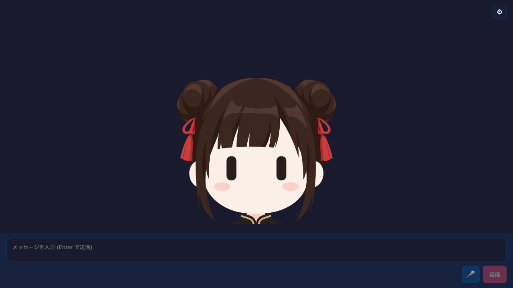
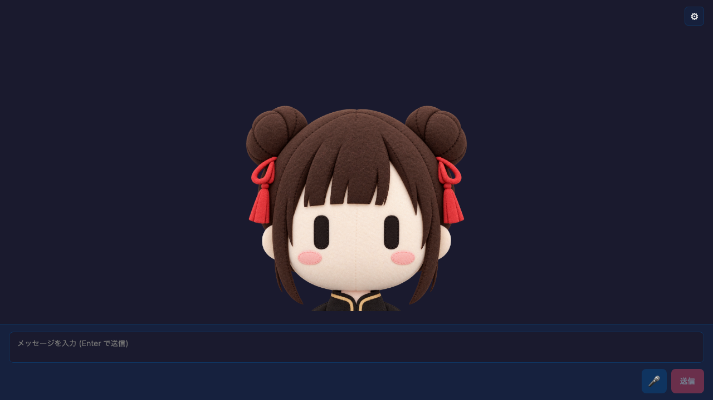

# Single Image Avatar Chat

Core 0.26.23 uses published Chat 0.65.0 and Voice 0.28.0. Select
`deepseek-flash` for DeepSeek-V4.1-Flash-1017; this rolling API ID follows
provider updates. Fish Audio's Model selector includes `drama-3` and
`drama-3-preview` for one-shot, single-speaker speech. The preview may change;
`s2-pro` remains the default. Voice 0.27.0's empty-audio and Piper Plus model
input fixes are included; Piper Plus language selection is not exposed here.

<p align="center">
  
  
</p>

A React chat example built with `@aituber-onair/core` and one avatar image.
Instead of swapping mouth images, it maps real TTS output volume to motion
applied to the whole image.

## Features

- Uses one transparent PNG or JPG
- Includes illustration and felt-puppet Miko variants
- Normalizes the TTS audio RMS level and maps it to motion
- Includes Bounce motion with jumps, alternating tilts, and landing squash
- Includes Puppet Wobble motion with smaller vertical and side-to-side movement
- Settles at the original position when speech stops
- Supports image replacement and a motion preview from Settings
- Retains the LLM, TTS, streaming, and emotion-effect controls from the
  PNGTuber example

Gemini 3.8 Flash TTS and Flash-Lite TTS are selectable in Voice settings.
The existing preview model remains the default; Gemini 3.8 uses the style
prompt and ignores language code.

## Voice input

Press the microphone button on the left of the chat form to start voice input,
and press it again to stop. The `⌃` button next to it opens the listening mode
and service options. The choices are saved in the browser.

- Listening mode: **一回だけ** (once) sends one utterance and stops.
  **継続して会話** (continuous) listens again after the reply has been generated
  and spoken
- Service: **ブラウザ** (Web Speech API), **OpenAI**, **Gemini**, or
  **ローカルサーバー（OpenAI 互換）** (local server). The example
  uses `@aituber-onair/transcription` and sends each confirmed utterance as a
  chat message
- OpenAI and Gemini use the same API keys as the LLM settings, and the keys can
  also be entered from the menu. Keys are sent from the browser directly to each
  service, so avoid shared devices. Listening is billed by each service
- OpenAI and Gemini do not accept audio until the connection is ready. Right
  after pressing the microphone the form shows a connecting status, and the
  button changes once you can speak

For a server that accepts multipart `POST /v1/audio/transcriptions` and returns
JSON with a `text` string, select **ローカルサーバー（OpenAI 互換）** in the mic
menu. Enter **サーバー URL** as an origin, a `/v1` base, or a full endpoint, and
check the displayed request URL. The URL starts empty. **モデル（任意）** and
**API キー（任意）** can stay blank unless the server requires them. These
settings, including the local key, are saved separately from the LLM keys in
this browser. Audio and any key go to that URL; use a server you trust.

Presets list only verified servers; pull requests for additional presets are
welcome. The **speech.cpp** preset sets `http://127.0.0.1:8080`. For example, run
`speech serve reazonspeech-v2 --cors-origin <page-origin>`, replacing
`<page-origin>` with the Origin shown in the mic menu. Speak after the listening
indicator appears, then pause to send the final transcript as a chat message.
Local input sends final results only, with a `ja-JP` language hint. Both once
and continuous modes are supported. See the [local STT guide](../../../../docs/local-stt.md)
for server setup, CORS, HTTPS, and troubleshooting.

## Setup

For `openai-compatible`, choose a local-server preset or enter an origin, a
`/v1` base URL, or a full `/chat/completions` URL. Fetch the model list, select
a model, and run **Test connection** before chatting. See the
[Local LLM setup guide](https://github.com/shinshin86/aituber-onair/blob/main/docs/local-llm.md).

For `OpenAI-Compatible TTS`, enter an origin, a `/v1` base URL, or a full
`/audio/speech` URL. **Detect server** fills in the model and voice lists when
the server provides them, and **Test speech** plays a short sample. See the
[Local TTS setup guide](https://github.com/shinshin86/aituber-onair/blob/main/docs/local-tts.md).


```bash
cd packages/core/examples/react-single-image-avatar-app
npm install
npm run dev
```

Open **Settings** and use the **Avatar & Motion** tab to choose a bundled avatar
or upload one image, then select Bounce or Puppet Wobble independently. LLM,
TTS, and streaming settings are under **AI, Voice & Streaming**.
**Preview motion** works without an API key or a configured TTS engine.

Settings are stored in `localStorage` under
`react-single-image-avatar-app-settings`. Uploaded images remain in memory only and
reset to the bundled image after a reload.

## Audio-driven motion

`src/hooks/useAudioMotion.ts` plays TTS output through the Web Audio API and
measures its RMS level each frame. `src/hooks/useSingleImageAvatarMotion.ts`
applies either `src/lib/bouncyAvatarMotion.ts` or
`src/lib/puppetWobbleMotion.ts` to the whole image.

The browser Web Speech API plays audio directly and does not expose audio
bytes, so it cannot drive motion from the real waveform. The Settings motion
preview remains available with that engine.

## Bundled image

The bundled images are `public/avatar/miko-avatar.png` and
`public/avatar/miko-puppet-avatar.png`. Both have transparent backgrounds. The
puppet version converts the same Miko design into a felt-doll style without
adding a mouth. The original illustration was generated with ChatGPT from a
Miko image using a
[prompt shared by Serio_ai (@Multi_Serio_Ai / APG)](https://x.com/Multi_Serio_Ai/status/2100800237619347535).
Thank you to the author for sharing the prompt.

## Updated Chat and Voice options

This example uses published Chat 0.65.0 and Voice 0.28.0 through Core.
New Chat models are available in the model selector, including GPT-6.1 Sol,
GLM-5.3 FlashX, Mistral GLM-5.3, and the new OpenRouter options. Models use
Chat's capability checks and model-specific reasoning defaults. The avatar
examples keep their existing reasoning UI; OpenAI's casual preset selects
`low` for GPT-6.1 Sol. Mistral GLM-5.3 and OpenRouter Nemotron are text-only;
the new OpenRouter Qwen models support images. Mistral GLM-5.3 requires an
eligible subscription tier, and native Z.ai browser calls may fail on CORS.

Select **Deepgram Flux** for English-only, one-shot MP3 speech. Enter a
Deepgram API key and select a named voice from the public v2 catalog.
Haley is always available; refreshes preserve the selected voice and keep
the previous list on empty or failed responses. Optional Speed is 0.5–1.5
in 0.05 steps. Vite development and preview proxy `/api/deepgram/v2/speak`
and `/api/deepgram/v2/models` to Deepgram. Production needs equivalent
authenticated backend routes with API keys kept server-side.

ElevenLabs `eleven_v4` retains Stability and Similarity but disables Style,
Speed, and Speaker Boost. Cartesia offers `sonic-3.6` and
`sonic-3.6-2026-08-27` with `sonic-3.6` as the default and `sonic-3.5` still selectable. Gradium's
model selector defaults to production; `gradium-tts-beta` currently aliases
production and tracks future betas. Switching back to Gradium resets the model
to production.
Chat 0.64.0 adds the OpenRouter public preview Mistral Large 4
(`mistralai/mistral-large-4-0`) after Pareto, with text and image input. Its
reasoning defaults to `none` for responsive chat. The model selected when
switching to OpenRouter is unchanged.

Chat 0.63.0 adds Claude Haiku 5.5 at the end of the Claude model list; the
model selected when switching to Claude is unchanged. Claude requests now use
`low` effort for faster replies.

Chat 0.62.0 adds the OpenRouter options Ling 3.1 Flash, Solar Pro 4, Solar
Mini4, MiMo V2.6 Flash, Apodex 1.1 Mini Free, and Pareto 26.10 Preview. MiMo
and Pareto accept images; the others are text-only. Core now lists Ling 3.1
Flash first, so switching the provider to OpenRouter selects it.

Select **OpenRouter** as the TTS engine for the public-preview
`microsoft/mai-voice-2.1` and `microsoft/mai-voice-2.1-flash` models. No model
is preselected. After you choose one, its voices load and an English voice is
selected; you can pick another. A voice from the previous model is never reused.
The TTS API key field shares the OpenRouter key from the LLM settings, so a key
entered there appears here as well. Both models are previews without an SLA and are not recommended for
production; catalogs checked on October 1, 2026 had no Japanese voices. The
sample calls OpenRouter directly from the browser, so the API key is visible to
the page; deploy shared apps behind your own backend.

See the [Core model update notes](../../README.md#chat-and-voice-model-updates)
for endpoint details and limitations.

## OpenRouter model catalog

The sample reads `GET https://openrouter.ai/api/v1/models` without an API key or
generation probes. Search covers model IDs and names; filters distinguish zero
published price, paid, and unknown pricing. These labels do not guarantee
availability, account access, quotas, routing, or actual charges.

A fresh catalog replaces curated choices. Failed refreshes retain last-good
metadata with a warning; without metadata, curated and legacy IDs are clearly
unverified fallback choices. Refresh never changes the selected model or API
keys. Saved legacy probe results are treated only as IDs. Removed selections
block new generation invocations, and changed pricing requires explicit
acknowledgement. An invocation already inside an SDK retry or rate-limit wait
cannot be cancelled by a later catalog refresh.
Vision and advanced options require both catalog metadata and SDK support.
Unknown dynamic models keep advanced features off. SDK request defaults,
including the 5000-token limit and `reasoning.exclude=true`, still apply and can
exceed a model's limits; this sample does not modify the public SDK registry.

### Model and voice updates

New OpenAI chat settings use `gpt-5.6-luna`. New or blank Gemini TTS settings
use `gemini-3.8-flash-tts`; explicit saved legacy models still load. Legacy
3.1/2.5 TTS models have earliest shutdown on 2026-11-17. Cartesia defaults to
`sonic-3.6`, with `sonic-3.5` still selectable.

OpenAI speech settings filter nine or thirteen voices by model and reset an
incompatible voice to alloy on model changes. The Speech API models shut down
on 2027-01-06; their Realtime-only successor is not supported here.
OpenRouter TTS offers ElevenLabs v4/v4 Turbo with model-scoped catalog voices
and MP3 playback, alongside MAI preview PCM wrapped as WAV. No static voice
allowlist is used for ElevenLabs. Fish Audio S1 retires on 2026-12-31;
S2.1 Pro Free is free through 2026-11-30. Gradium's beta alias currently
matches default and tracks future betas; Voice Similarity is deprecated and ignored.
